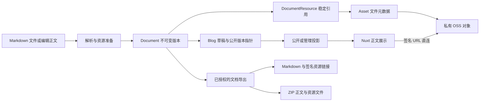
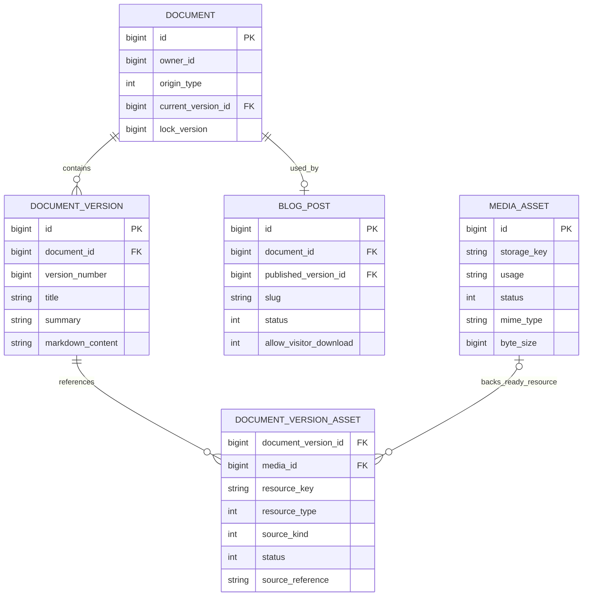
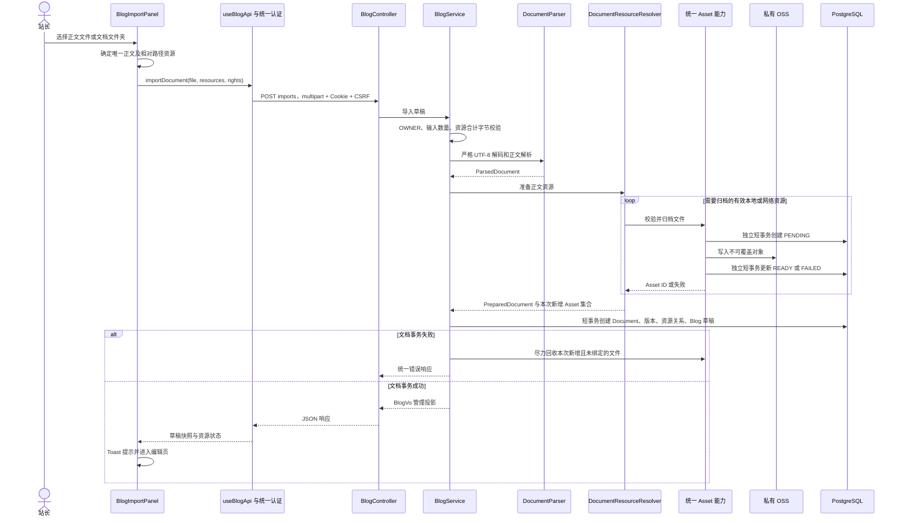
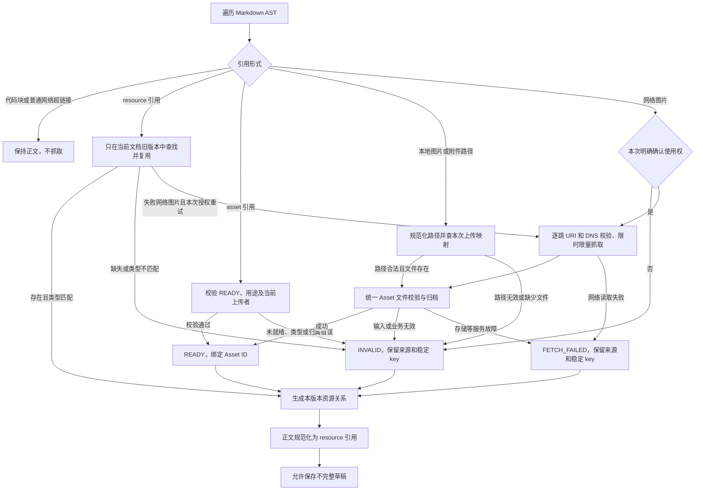
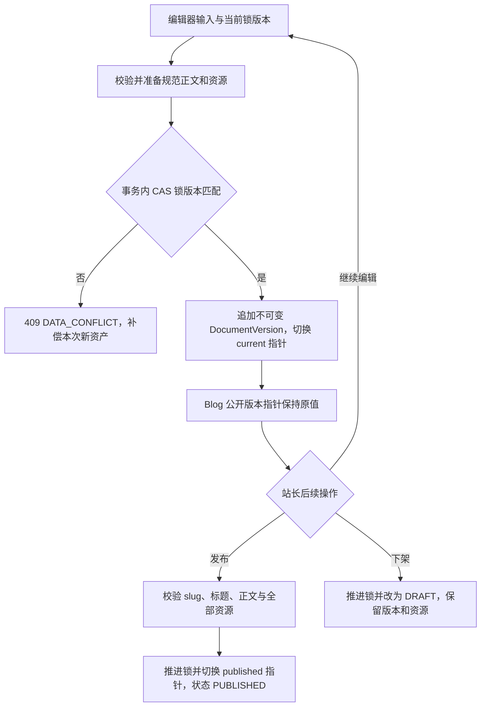
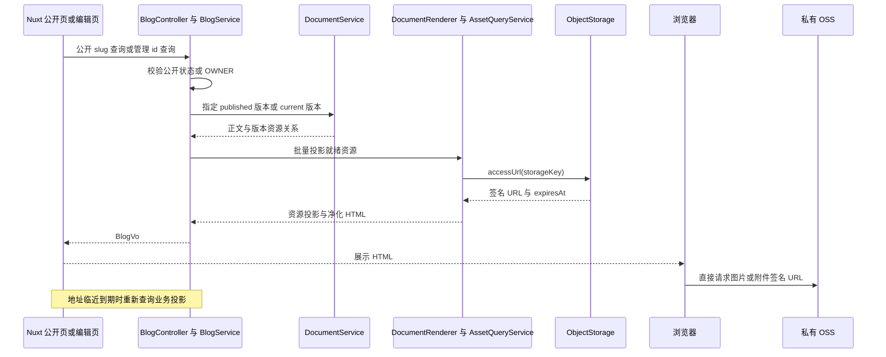
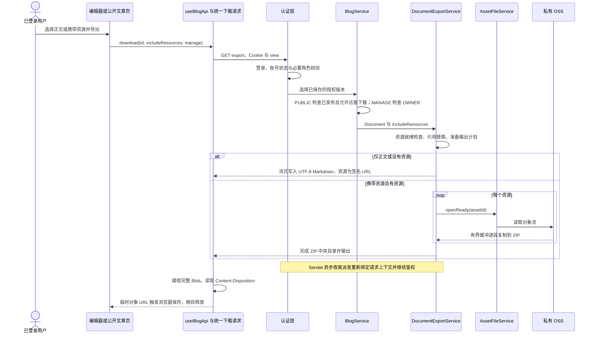

# 博客文档导入、展示与导出全链路

本文描述当前代码，而非未来知识库架构。当前支持 **UTF-8 Markdown 导入、Markdown 导出、携带正文资源的 ZIP 导出**。DOCX/PDF 没有接入；RAG 没有接入。文档内的 Mermaid 图可直接渲染，也可复制到支持 Mermaid 的工具中编辑。

独立图源码位于 [diagrams/document](diagrams/document/)：总览、数据模型、导入时序、资源处理、保存发布、展示时序、导出时序共七份 `.mmd`。它们从本文 Mermaid 图块直接提取，本文是编辑源，独立文件是交付副本。

## 1. 核心事实与职责



| 组件 | 承担的职责 | 不承担的职责 |
|---|---|---|
| `BlogImportPanel` | 文件/目录选择，明确正文，计算相对资源路径 | UTF-8 解码、OSS 上传规则、数据库写入 |
| `BlogEditor` | 编辑缓冲、已保存快照、操作状态、资源修复入口 | 决定公开权限、持久化资源链接 |
| `useBlogApi` | multipart、查询参数、下载动作、公开缓存失效 | 文件格式解析、资源归属规则 |
| 统一请求/认证层 | 会话快照、CSRF、401/403、错误响应转换 | 博客发布或资源处理规则 |
| `BlogController` | HTTP 参数及响应适配，输出流接入 | 解析文档、上传文件、复制鉴权规则 |
| `BlogService` | 管理权限、草稿与发布生命周期、公开版本选择、下载许可 | OSS SDK、原始格式解析 |
| `DocumentParser` | 来源格式到 `ParsedDocument` | 账号、数据库、OSS |
| `DocumentResourceResolver` | AST 资源识别、稳定引用、复用/归档资源、失败状态 | Blog 是否公开、任意本地磁盘读取 |
| `DocumentService` | 文档身份、不可变版本、资源关系、CAS 锁 | 页面分类、签名 URL |
| `DocumentRenderer` | 资源投影、HTML 净化、导出引用替换 | 回写正文、读取 OSS 图片字节 |
| `DocumentExportService` | 导出格式选择和正文/资源输出 | 登录判断、重新解析原始文件 |
| `AssetFileService / AssetUploadComponent` | 文件校验、PENDING/READY/FAILED、字节读取、未绑定文件补偿 | Blog 公开状态、正文语义 |
| `AssetQueryService / ObjectStorage` | 文件元数据、存储对象、临时签名访问地址 | 文章公开版本选择 |

Source of Truth 是 `blog_post + document + document_version + document_version_asset + media_asset`。原始 Markdown 文件、HTML、OSS URL 和导出文件都不是第二份正文事实。

## 2. 数据模型与版本语义



`document_version_asset` 和 `media_id` 沿用既有表名/字段名，表示统一文档资源与 Asset 的关系，不能据名称再造一套 Media 业务。每个就绪资源关联一个 Asset；失败资源的 `media_id` 为空。

| 字段 | 含义 |
|---|---|
| `Document.versionId` | 不可变内容版本的数据库 ID |
| `Document.version` | 该内容版本生成时的版本号 |
| `Document.lockVersion` | 当前写入锁计数；保存、发布、下架均会推进 |
| `document.current_version_id` | 最新已保存版本，不代表访客可见版本 |
| `blog_post.published_version_id` | 最近发布版本；公开列表、详情、导出使用它 |
| 管理 `BlogVo.version` | 当前 `lockVersion`，更新时原样带回 |
| 公开 `BlogVo.version` | 公开内容的版本号，不用于管理写入 |

例如：保存首版得到内容版本 1、锁 1；发布后锁为 2，内容版本仍为 1；下一次保存会创建内容版本 3。内容版本号可以不连续，不应根据“版本号加一”推算数据库版本 ID。

规范正文示例：

```markdown

[附件](resource://另一个资源键)
```

`resource://key` 是已绑定文档引用；`asset://id` 是编辑器上传完成、尚待保存绑定的输入引用。后者保存时校验文件就绪、用途及当前上传者归属，然后转换为前者。签名 URL 永远不应覆盖这些引用后再保存。

## 3. 文档导入流程



### 前端输入约定

单文件模式用 Nuxt UI `UFileUpload` 的 `v-model` 保存正文。额外文件按 `file.name` 匹配，适合平铺目录；有子目录时应选择文档文件夹。目录模式只用一个隐藏的原生 `webkitdirectory` 输入做选择，表单、按钮仍复用 Nuxt UI。

目录中只有一份 `.md` 时自动选中；有多份时必须明确选择；没有正文、空正文、错误扩展名或重复资源路径不能提交。前端这些判断只是选择体验，后端继续执行最终校验。

假设正文是 `bundle/docs/post.md`，它引用 `images/a.png`：上传 part 的 filename 必须是 `images/a.png`，不是 `bundle/docs/images/a.png`，也不是 `a.png`。目录模式只收集正文所在目录及其子目录的候选文件。

multipart 字段如下：

| 字段 | 传输约定 |
|---|---|
| `file` | 一份 UTF-8 `.md` 正文 |
| `resources` | 多个文件 part；每个 filename 是正文相对路径 |
| `remoteRightsConfirmed` | 当前操作是否允许抓取有使用权的网络图片 |

当前导入是同步调用，不使用导入任务队列。数据库基线里的 `document_import_job`、`document_processing_task` 表尚未接入这条链路，不能把存在表视为实现了任务状态机。

### 后端解析约定

Markdown Parser 校验格式、严格 UTF-8、正文大小，去掉 BOM、统一换行。标题优先取首个顶层 H1，否则取文件名。原始文件字节不作为后续正文存储来源；ParsedDocument 进入同一资源准备和保存流程。

## 4. 图片、附件与失败处理



图片节点都会参与资源处理；普通 HTTP(S) 附件超链接仍是外链，不下载、不进入 DocumentResource。本地附件、编辑器上传附件和稳定资源引用进入资源体系。同一类型及原地址在一次正文准备中只处理一次；代码块中的地址示例不触发抓取。

资源状态是文档引用的事实，Asset 状态是文件生命周期的事实，两者不能混用。`READY` 资源必须有 Asset ID；`INVALID` / `FETCH_FAILED` 不绑定 Asset。旧版本未再被正文引用的资源关系不会复制到新版本，但旧版本及其文件不会因此删除。

网络图片只支持当前 PNG/JPEG 能力。抓取层筛选 MIME，Asset 层再检查真实图片内容、尺寸、MIME 匹配并重编码。URI 不允许 userinfo、fragment 或非允许端口；实际连接的 DNS 解析器拒绝非公网目标，重定向逐跳验证，禁用自动重定向、Cookie 和自动重试。不会带入站长 Cookie 或服务端登录凭据。

本地路径只查询上传映射，不读取服务器磁盘；绝对路径、父目录逃逸、编码路径分隔符及非法字符被拒绝。原始来源只对管理投影开放，常见鉴权查询参数及 userinfo 会脱敏。

发布和完整导出要求资源就绪。失败草稿通过编辑器待修复区域提示：重新上传文件并替换引用，或删除无用引用；明确授权后的失败网络图片可以重试并保留原 key。脱敏后的受保护来源若不能重试，需要重新提供有效源地址。

### 事务与补偿边界

先准备并上传资源，再用短事务保存 Document 和 Blog。资源上传使用自己的 PENDING/READY/FAILED 短事务，OSS 调用期间不持有该事务。

资源准备整体失败或文档事务失败时，仅补偿本次新增、归属本人的未绑定 Asset。先删除数据库元数据；已被外键引用的对象不能删除，不能先删 OSS。删除失败记录安全日志并尽力继续，不能承诺数据库与 OSS 的分布式原子性。尚未绑定的编辑器上传、失败上传及删除失败的对象仍可能需要后续治理。

## 5. 保存、发布、下架



发布/下架接口也使用锁版本，图中状态变更都在同一事务中校验并执行；失败会回滚。首次发布之后文章标识不能更改。当前后端对 slug 执行长度、唯一性及首次发布后固定校验，字符格式正则已经停用；不能把前端“小写字母数字连字符”的提示当成实际服务端规则。

管理端输入与已保存快照分别维护。有未保存改动时，发布、下架、导出禁用。保存后才接受完整快照；后台签名地址刷新只更新 HTML/资源投影，不能覆盖输入。当前操作标识控制互斥，各按钮只显示自身加载状态。

## 6. 查询与展示



公开投影只读取已发布版本，`content=null`，不返回原始资源来源；管理投影含规范化正文、来源和当前锁版本。HTML 通过 AST 替换稳定引用，转义原始 HTML 并净化危险 URL。缺失资源指向不可用占位，不请求内部协议地址。

签名默认有效期为一小时，可由 `portfolio.media.signed-url-ttl` / `MEDIA_SIGNED_URL_TTL` 调整。前端缓存与刷新调度共用 30 秒余量；按响应内最早的资源到期时间判定。到期前刷新业务接口的投影，不修改正文、不拼接签名；刷新失败不立即无限循环请求。

普通资源不经过 Spring Boot 图片流代理；下架只影响公开列表、详情和公开下载，不撤销已经签发的 OSS URL。

管理保存成功后若签名生成发生服务故障，会返回已保存正文及 `previewIssue`，避免把展示问题当成保存失败诱导重复提交。公开展示与导出不使用这一管理预览降级。

## 7. 文档导出全链路



| 条件 | 输出 | 资源引用 |
|---|---|---|
| 不包含资源 | `document-{id}-v{version}.md` | 当前签名访问 URL，有有效期 |
| 包含资源，但文章只有正文 | 同上 `.md` | 无资源 |
| 包含资源，且文档存在资源 | 同名 `.zip` | ZIP 内相对路径 |

ZIP 内结构：

```text
document-2-v3.md
resources/
  稳定资源键A/image.png
  稳定资源键B/notes.txt
```

每个资源在独立 key 目录下，避免同名文件覆盖；只保留安全叶子文件名，拒绝目录穿越及 Windows 保留名风险。资源复制校验实际字节数，流由 try-with-resources 关闭。完整写入后才 `finish()`；中途失败释放压缩器但不生成中央目录，不能伪装成完整归档。

Controller 在响应提交前完成业务授权与输出计划准备。异步 Writer 只消费已授权 Document，不读取登录线程的 Sa-Token 上下文。Security starter 对 `REQUEST` / `ASYNC` 注册官方上下文 Filter，每次派发绑定并清理当前线程上下文，不跳过鉴权、不复制 ThreadLocal。

响应提交前的失败返回项目统一 JSON 错误；前端下载请求虽然按 Blob 接收，也会解析该 JSON 并进入现有 401/403 处理。输出中途失败时响应可能已经提交，无法再可靠替换 HTTP 状态或发送完整 JSON 错误，用户不能把收到部分字节当成完整文件。

**内存边界：**后端正文已有大小上限，资源逐个流式复制，不整体载入 JVM；导入时本地文件和抓取图片则按上限缓存在 byte[] 中。前端当前 `$fetch.raw` 将整个导出收进 Blob，再保存文件，因此还没有实现浏览器端流式落盘。不能根据后端使用 `StreamingResponseBody` 就宣称整条链路没有整文件内存占用。

## 8. API 与权限契约

统一前缀 `/api/v1/blogs`：

| 方法与路径 | 功能 | 权限/投影 |
|---|---|---|
| `GET /blogs?view=PUBLIC` | 分页公开摘要 | 无需登录，仅已发布版本 |
| `GET /blogs?view=MANAGE` | 分页管理摘要 | OWNER，最新草稿 |
| `GET /blogs/by-slug/{slug}` | 公开详情 | 无需登录，下架/不存在返回 404 |
| `GET /blogs/{id}` | 编辑快照 | OWNER |
| `POST /blogs` | 创建草稿 | OWNER + CSRF |
| `PATCH /blogs/{id}` | 追加文档版本 | OWNER + CSRF + 当前锁版本 |
| `POST /blogs/imports` | Markdown 导入草稿 | OWNER + CSRF，multipart |
| `POST /blogs/{id}/publish` | 发布已保存版本 | OWNER + CSRF + 当前锁版本 |
| `POST /blogs/{id}/unpublish` | 下架 | OWNER + CSRF + 当前锁版本 |
| `GET /blogs/{id}/export?view=PUBLIC` | 公开导出 | 登录、已发布、允许访客下载 |
| `GET /blogs/{id}/export?view=MANAGE` | 管理导出 | OWNER，最新已保存版本 |
| `POST /api/v1/assets` | 编辑器图片/附件上传 | 图片/附件要求 OWNER，绑定在后续保存中完成 |

上表 `/blogs` 是完整路径 `/api/v1/blogs` 的缩写。两种 view 共用核心服务，没有 admin/public 两套业务实现。Cookie 和 CSRF 由现有认证入口处理，不新增下载专用认证。

常见失败：401 会话无效；403 权限、账号状态或下载许可不足；409 文档锁冲突；格式不支持为 415；字段/输入资源总量错误通常为 422 VALIDATION_FAILED；容器级 multipart 超限为 413。单个资源问题通常成为草稿资源状态，不能一概等同于整个导入 HTTP 失败。认证失败刷新当前会话但不自动重放上传/保存请求。

## 9. 配置、领域常量及上限

下列为代码默认值，部署配置可以覆盖；不读取或记录真实 OSS 凭据。

| 来源 | 默认/固定值 | 语义 |
|---|---|---|
| `portfolio.document.max-content-bytes` | 2 MiB | UTF-8 正文及规范化正文上限 |
| `portfolio.document.max-resources` | 50 | 上传资源 part 数、去重后的正文资源数分别设限 |
| `portfolio.document.max-import-bytes` | 64 MiB | 本地资源合计，不含另行限制的正文 |
| `connect-timeout-ms` / `read-timeout-ms` | 3000 / 5000 | 获取连接、响应及读取上限 |
| `max-fetch-total-ms` / `max-redirects` | 15000 / 3 | 一次文档共享抓取预算、逐图重定向次数 |
| `AssetUsage.IMAGE` | 8 MiB / 4096 像素 | PNG/JPEG 图片实际字节与宽高上限 |
| `AssetUsage.ATTACHMENT` | 64 MiB | 单个附件上限 |
| Servlet multipart | 单文件及请求均 128 MB | 容器入口上限，不能替代文档/Asset 业务上限 |
| `DocumentPolicy` | `.md`、`asset://`、URI 2048、key 36、role 0、首版 1 | 稳定协议及数据库约定 |
| `DocumentPolicy.IO_BUFFER_BYTES` | 16 KiB | 网络读取/ZIP 复制的单次缓冲，不是文件上限 |
| `AssetPolicy` | 文件名 255、MIME 100 | 对齐数据库字段容量 |
| `BlogPolicy` | 默认页 1、默认数量 12、最大页 10000、数量上限 50 | 后端分页规则 |
| 前端博客常量 | 管理每页 20、公开每页 12、首页 4 | 当前界面展示需求 |
| 前端资源常量 | 签名刷新余量 30 秒 | 缓存判断与调度的共同来源 |
| 前端下载常量 | Blob URL 延迟释放 30 秒 | 给浏览器接管下载时间，与签名刷新余量是不同职责 |

标准 HTTP 状态/MIME 使用现有库常量。IP 前缀、位掩码、AST 标题级别及算法计数不是业务状态值；关键前缀已附上对应网络语义注释，没有将每个 0/1 都包装成通用常量。

## 10. 代码导航

后端源码根：`backend/mai-portfolio-modules/mai-portfolio-module-blog/mai-portfolio-module-blog-service/src/main/java/dev/amai/portfolio/blog/`。

| 环节 | 入口 |
|---|---|
| 文件选择 | [BlogImportPanel.vue](../../frontend/app/components/BlogImportPanel.vue) |
| 编辑与绑定 | [BlogEditor.vue](../../frontend/app/components/BlogEditor.vue) |
| multipart 与保存下载 | [blogs.ts](../../frontend/app/api/blogs.ts) |
| 下载错误及响应头 | [request.ts](../../frontend/app/api/request.ts) |
| 认证请求拦截 | [authInterceptor.ts](../../frontend/app/api/authInterceptor.ts) |
| 公开详情 | [公开文章页](../../frontend/app/pages/blog/%5Bslug%5D.vue) |
| 签名缓存与刷新 | [assetUrls.ts](../../frontend/app/utils/assetUrls.ts)、[useAssetUrlRefresh.ts](../../frontend/app/composables/useAssetUrlRefresh.ts) |
| HTTP / 业务入口 | 后端根下 `controller/BlogController.java`、`service/impl/BlogServiceImpl.java` |
| 解析与资源准备 | 后端根下 `component/MarkdownDocumentParser.java`、`DocumentResourceResolver.java`、`RemoteResourceFetcher.java` |
| 文档持久化 | 后端根下 `service/impl/DocumentServiceImpl.java` |
| 投影与导出 | 后端根下 `component/DocumentRenderer.java`、`service/impl/DocumentExportServiceImpl.java` |
| 稳定常量与配置 | 后端根下 `constant/BlogPolicy.java`、`DocumentPolicy.java`、`config/DocumentProperties.java` |
| 数据结构 | `V1__portfolio_and_document_core.sql`、`V5__document_resources.sql` |

## 11. 维护性、扩展边界和当前债务

同类图片/附件继续使用统一 Asset 能力，不需要新的上传 Controller/Service。下一种文档格式从现有 `DocumentParser → ParsedDocument` 边界接入，资源准备、文档保存、博客发布和查询流程继续复用。当前只有一个 Parser 实现，没有提前增加解析器 Registry 或格式选择框架。

RAG 第二阶段从 `DocumentService.read(id, versionId)` 返回的稳定快照开始消费正文及资源语义，不重新解析原始上传文件。本轮没有增加 Chunk、Embedding、向量写入、MQ、任务状态机或知识库同步；它们没有第一阶段博客调用方。

当前需要承认的限制：

- 前端与后端分页/输入限制仍分属两种语言，已集中并明确服务端权威来源，没有自动契约生成。
- 前端导出完整 Blob 可能占用较大浏览器内存；本轮未改变下载协议，也不额外建立导出任务系统。
- 抓取公网判断当前保守过滤部分前缀，可能拒绝一些合法公网地址；本轮命名和注释保留其行为，没有顺便改动 SSRF 安全策略。
- 失败 Asset、未绑定上传和跨存储删除失败的对象可能保留；目前没有通用资产回收任务，不能承诺自动清理所有孤儿对象。
- 数据库仍保留尚未接入的任务表，前端 slug 字符提示与现行后端长度规则并不完全一致；这里记录实际状态，没有在注释任务中恢复历史规则。
- .md 导出的图片/附件链接会过期，需要重新导出获得新链接；ZIP 携带资源才支持脱离签名访问的本地使用。
