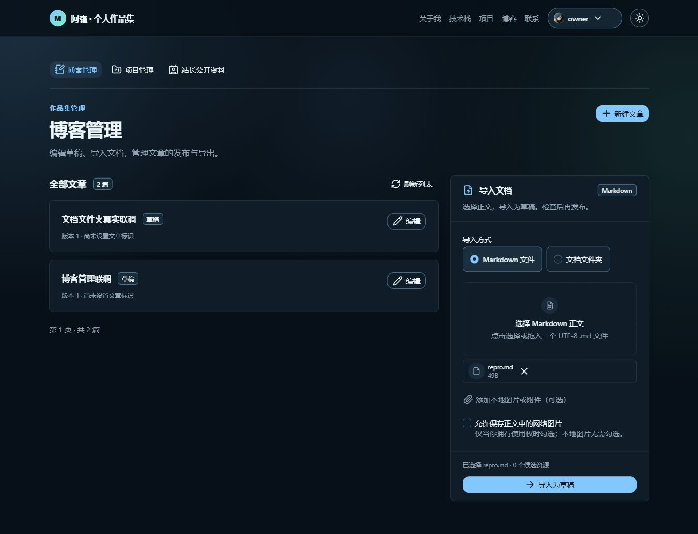
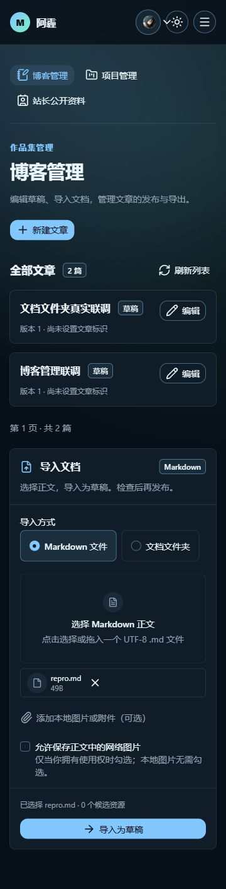
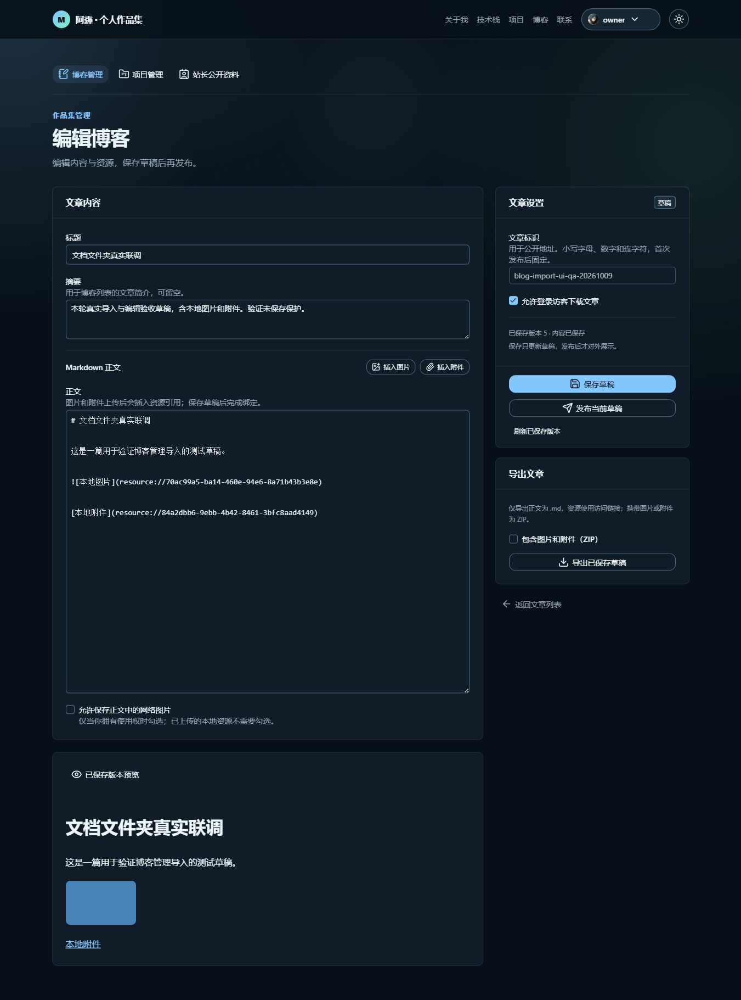

# 博客管理界面修复与联调记录

功能分支：`feature/blog-admin-import-ui`。父分支：`feature/blog-document-lifecycle`（起点 `0cbd494`）。改动直接位于维护者的主工作目录，没有新增工作树。维护者原有暂存文件、登录页修改和博客后端修改不纳入本轮提交。

## 功能正确性与接口验证

真实环境：Nuxt `127.0.0.1:3000` → Spring Boot `127.0.0.1:9333` → PostgreSQL / Redis / 私有 OSS。使用已登录站长账号和专门生成的非敏感联调文件；没有用模拟返回替代以下页面操作。

| 接口或功能 | 实际验证结果 |
|---|---|
| `GET /api/v1/blogs?view=MANAGE` | 显示真实文章列表、状态、版本及摘要；分页以成功返回的页码为准 |
| `POST /api/v1/blogs/imports`，单 Markdown | 选择正文后按钮可用，真实导入为草稿 1，进入编辑页 |
| 同一导入接口，文档文件夹 | 从 `single/docs/post.md` 导入草稿 2；`images/sample.png` 和 `notes.txt` 相对路径正确，均进入现有资源体系 |
| 文件删除与无效选择 | 移除正文、只有附件、空 Markdown、错误扩展名均不能提交；无 Markdown 的文件夹给出原因 |
| 多份 Markdown | 明确选择要导入的正文，未选之前不能提交；选择嵌套正文后正确计算所在目录的候选资源 |
| `GET /api/v1/blogs/{id}` | 读取真实草稿、版本、统一文档正文和资源投影 |
| 图片展示 | 已保存预览中的图片实际加载成功，尺寸 128×80；浏览器访问 OSS 域名，不经 Spring Boot 代理图片字节 |
| `PATCH /api/v1/blogs/{id}` | 修改摘要、文章标识后实际保存；版本从 1 → 2，后续保存为版本 4 |
| `POST /api/v1/blogs/{id}/publish` | 实际发布，版本 3；公开入口出现，首次发布后的标识不可编辑 |
| 未保存保护 | 修改摘要后发布、下架、导出均禁用，不把服务端完整快照覆盖回未保存输入 |
| `POST /api/v1/blogs/{id}/unpublish` | 实际下架，版本 5，联调文章恢复为草稿 |
| `GET /api/v1/blogs/{id}/export`，正文与 ZIP | 后端重启后，维护者在原 Edge 页面按正文 .md 与包含资源 ZIP 复验，确认“导出功能正常” |
| 响应式布局 | 1366×900 为列表与导入双栏；375×812 为单栏；实际页面内容宽度没有横向溢出 |
| 操作加载提示 | 后端重启后真实点击导出，DOM 确认导出按钮加载、保存按钮不加载；操作期间互斥禁用 |

导出之前的失败原因已经由维护者提供的真实日志确认：Sa-Token 1.45 的请求上下文 Filter 没有覆盖流式响应的 `ASYNC` 收尾派发，MVC 鉴权再次执行时访问到了未绑定的上下文。此前偏向归因于工具无法接收下载的判断不成立。

## 设计与职责边界

- `BlogImportPanel` 只负责文件选择、明确正文以及相对资源路径。Nuxt UI `UFileUpload` 的 `v-model` 是文件模式的唯一正文来源，启用条件和提交读取同一个状态。
- 文件模式用于单篇正文及同层资源；目录模式保留正文所在目录下的资源结构。多份正文由用户选择，不默认拿第一份。
- Nuxt UI 当前文件上传组件没有目录选择能力，因此目录模式仅使用一个隐藏的原生 `webkitdirectory` 输入。按钮、字段、状态展示、文件列表继续复用 Nuxt UI，没有自造上传组件库。
- `useBlogApi` 负责 multipart 序列化和现有接口调用，不猜测目录层级。后端继续承担文件安全校验、资源绑定、正文规范化和版本规则。
- 编辑器只维护当前输入及服务端已保存快照。导出和展示以已保存文档为准；签名 URL 刷新只更新展示投影，不覆盖输入。
- 编辑器用一个当前操作标识实现互斥，每个按钮只显示自身操作的加载状态，保存、上传、发布、下架、导出不互相冒充。
- 异步上下文修复位于 Security starter：复用官方 Filter，注册 `REQUEST` 与 `ASYNC`，沿用官方顺序与 finally 清理。没有绕过鉴权，没有把线程上下文补丁塞进 Blog Controller，也没有升级整套认证依赖。
- 原有登录、账号状态、OWNER、CSRF 与公开下载规则继续由现有认证和业务边界承担。

Sa-Token 官方在后续版本说明中记录了相同问题及 REQUEST/ASYNC 注册修复，参考：[v1.46.0 发布说明](https://sa-token.com/blog/release/sa-token-v1-46-0.html)。项目仍保留现有 1.45 依赖及 Redis 兼容边界。

## 常量、注释与维护性检查

- 管理 URL 复用现有 `ADMIN_PATHS.blogs`，没有新增重复路径常量。
- 请求分页大小和分页控件共用 `BLOG_PAGE_SIZE`；输入上限、图片选择类型、资源状态文案及临时下载地址释放时间集中于 `constants/blogs.ts`。
- 前端输入限制只改善体验，后端 BlogPolicy / AssetUsage 是最终校验依据；没有凭空增加前端上传大小规则。
- 注释说明相对路径基准、目录选择的组件库限制、File 浅引用、未保存保护、签名地址刷新、下载来源和异步上下文生命周期。
- 新增同类资源无需复制 Controller / Service；上传仍调用现有统一 Asset API，博客导入仍走现有 Document 主流程。
- 替换 OSS 不需修改这些页面的业务规则，资源投影和统一文件能力继续承担存储边界。
- 清除了旧管理列表里分散的三个文件选择入口和其导入状态实现，旧能力由 `BlogImportPanel` 承担；没有新旧入口并行或长期 fallback。
- 错误继续进入现有函数式 `useFeedback` Toast，位置由已有全局配置负责；没有增加确认弹窗或页面固定错误标签。

## 当前扩展点与主动推迟项

当前支持单 Markdown、带目录的 Markdown 及现有图片/附件资源。新增 Parser 应继续接入后端 Document 解析边界，前端按真实已支持格式调整选择与说明，不复制博客保存、展示、导出或文件服务。

本轮没有提前建立上传 Strategy / Registry、通用管理 God Service，也没有扩展 DOCX、PDF、RAG、Chunk、Embedding、MQ 或知识库同步。

## 技术债务与验证边界

- 文件模式的额外资源按文件名匹配；有子目录应选择目录模式。目录模式明确支持正文目录及其子目录，不能把父目录文件含糊地当成正文相对资源。
- 前后端输入限制目前分属不同语言；前端已集中定义并注明服务端权威来源，尚未引入无当前必要性的自动契约生成。
- 联调草稿 1、2 保留供维护者检查，草稿 2 已下架；本轮没有永久删除数据。
- 内置浏览器工具两次未返回下载文件，因此导出的实际浏览器验收以维护者 Edge 复验为依据；本轮没有取得文件进行 ZIP 条目、文件字节或离线解压比对，不声称完成这些内容检查。
- 本轮没有对插入图片/附件、网络图片抓取、OSS 故障、账号被禁用等全部组合重新进行浏览器验收，不能将它们声称为全部实测通过。
- 已有登录页 hydration 警告属于独立现存问题，未将维护者登录页改动混入本轮。

## 测试与构建

- 与当前故障直接相关的 `SaTokenAsyncDispatchIntegrationTest`：真实嵌入式 Tomcat HTTP，2 个用例通过，验证登录后的流式输出及 ASYNC 再鉴权、匿名导出返回 401。测试会话存储隔离为内存，不模拟 Sa-Token 上下文；真实页面联调仍使用现有 Redis / OSS。
- 后端必要打包构建通过，跳过无关测试。
- 前端类型检查通过，生产构建通过。
- 后端重启后，维护者已在 Edge 确认导出正常；页面实际加载状态也已确认正确。不以构建或上述回归测试替代真实导出验收。

## 页面截图

