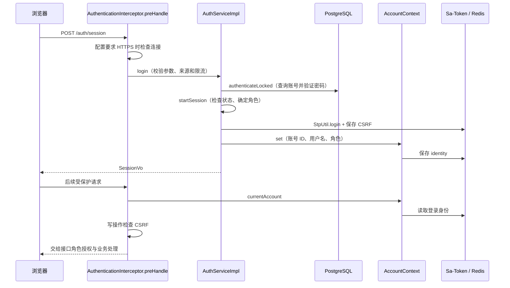
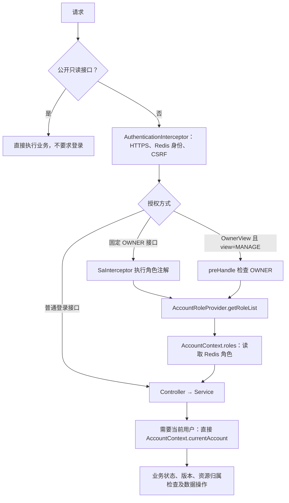
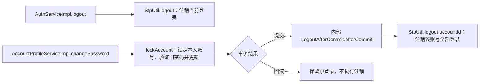

# 认证与权限调用链

共享上下文直接复用 Sa-Token Redis 会话，保存账号 ID、用户名和角色。普通认证、角色判断不查账号表；调用方直接使用 AccountContext，不经过身份转发服务。密码摘要及数据库账号实体不进入上下文。

## 登录与后续请求

登录时才查账号、验证密码和状态，并建立会话；之后直接取同一份 Redis 身份。

## 权限和业务职责

同一入口不叠加两种 OWNER 检查。公开/管理混合查询保留 OwnerView 条件授权；公开请求不因此变成登录接口。上传入口按用途检查角色；AssetServiceImpl.resource 只保留上传者或 OWNER 的资源访问规则。

BlogServiceImpl、AssetServiceImpl 和账号资料服务直接读取共享上下文，不再通过身份 Service 转发。读写博客、资料和资源仍按业务需要访问数据库。

## 注销、改密与账号访问调整

站长通过 `PATCH /api/v1/account/{accountId}/access` 提交 `{status: "DISABLED"}` 或 `{type: "NORMAL"}`（也可同时传入两项）。停用或改变类型成功提交后，`AccountProfileServiceImpl.updateAccess` 注销目标账号全部登录；回滚不注销。启用账号后需要重新登录。接口只维护访问能力，不增加账号列表或另一套管理系统。

账号资料写操作自己读取并锁定数据库账号，不把这一步放进所有请求的鉴权链。改密后的注销必须等数据库提交成功；这一步保留为账号资料服务内部的事务回调。

## 关键代码

| 职责 | 位置及方法 |
| --- | --- |
| 共享身份 | security starter：security.context.AccountContext.currentAccount/set/roles |
| 登录、恢复、注销 | system：service.impl.AuthServiceImpl.login/current/logout |
| HTTPS、身份与 CSRF | system：auth.AuthenticationInterceptor.preHandle |
| 角色回调 | system：auth.AccountRoleProvider.getRoleList |
| 改密、账号访问调整与提交后注销 | system：service.impl.AccountProfileServiceImpl.changePassword/updateAccess、LogoutAfterCommit.afterCommit |

## 已确认的取舍

- 直接改数据库账号状态或角色不会实时刷新 Redis 身份；重新登录刷新，需立即失效时显式注销该账号会话。
- 旧会话不含当前身份结构时要求重新登录，不查库回填。
- Redis 故障按错误处理，不回退到数据库鉴权。
- 改密提交后 Redis 注销失败会报错，已提交的密码不会回滚；没有后台补偿或逐请求查库兜底。
- 角色含义、CSRF/HTTPS 与资源归属规则不变；新增的访问调整接口仅供 OWNER，不新增依赖、表或基础设施。
