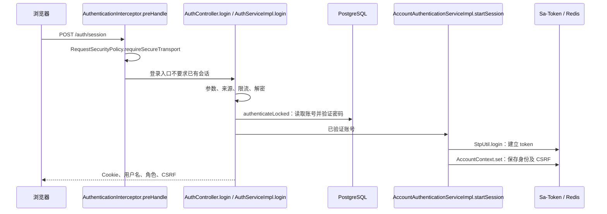
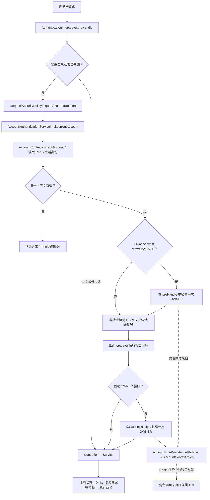
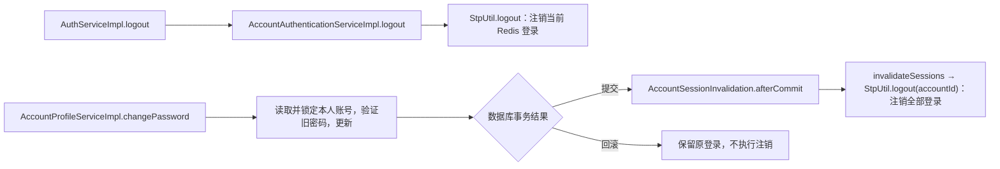

# 认证与权限调用链

普通接口通过现有 Sa-Token Redis 会话取得身份，不查询账号表，也不逐次比对数据库凭据版本。

## 登录：查账号，建立 Redis 上下文

`AccountConvert.toSession` 只复制账号 ID、用户名、类型和状态，不复制密码摘要、凭据版本或数据库审计字段。Redis 命名空间和会话 TTL 沿用现有配置。

## 普通请求：Redis 身份 → 入口授权 → 业务

- 固定 OWNER 接口使用既有 `@SaCheckRole`。公开/管理共用入口用 `@OwnerView`，只有 `view=MANAGE` 时要求 OWNER；同一入口不叠加两种 OWNER 检查。
- `AssetController.upload` 允许普通账号上传头像，其他用途在入口检查一次 OWNER。
- `AssetServiceImpl.resource` 保留“上传者或 OWNER”规则，不再重新检查 HTTPS、查账号表或调用旧 Owner 服务。
- `BlogServiceImpl`、标签创建和导入记录查询不再重复验证入口角色。内部读取保存结果不重新走授权。
- 业务读取和保存仍按需要访问 PostgreSQL；“不查库”指认证及角色查询。

## 注销与改密

账号资料写入属于业务操作；`lockCurrentAccount` 不挂在普通博客鉴权链上。

## 明确的取舍

- 直接在数据库修改账号状态或角色，不会立即改变现有 Redis 身份；重新登录刷新。需要立即失效时显式注销对应账号会话。
- 旧会话没有身份上下文时要求重新登录，不增加查库回填。
- Redis 故障报错，不降级为数据库鉴权。
- 改密提交后删除会话。Redis 删除失败会报错，已提交的密码不会回滚；不再声称数据库凭据版本能在每次请求中兜底。

## 关键代码

类位于各业务 service 模块的 `src/main/java/dev/amai/portfolio/` 下。

| 职责 | 类与方法 | 包 |
| --- | --- | --- |
| 请求入口 | `AuthenticationInterceptor.preHandle` | `system.auth` |
| HTTPS | `RequestSecurityPolicy.requireSecureTransport` | `system.auth` |
| 登录与会话读取 | `AccountAuthenticationServiceImpl.startSession/currentAccount` | `system.service.impl` |
| Redis 身份来源 | `AccountContext.set/currentAccount/roles` | `system.auth` |
| 角色回调 | `AccountRoleProvider.getRoleList` | `system.auth` |
| 改密后注销 | `AccountSessionInvalidation.afterCommit` | `system.auth` |
| 上传用途授权 | `AssetController.upload` | `asset.controller` |
| 资源归属判断 | `AssetServiceImpl.resource` | `asset.service.impl` |
