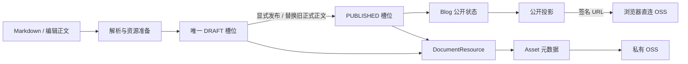
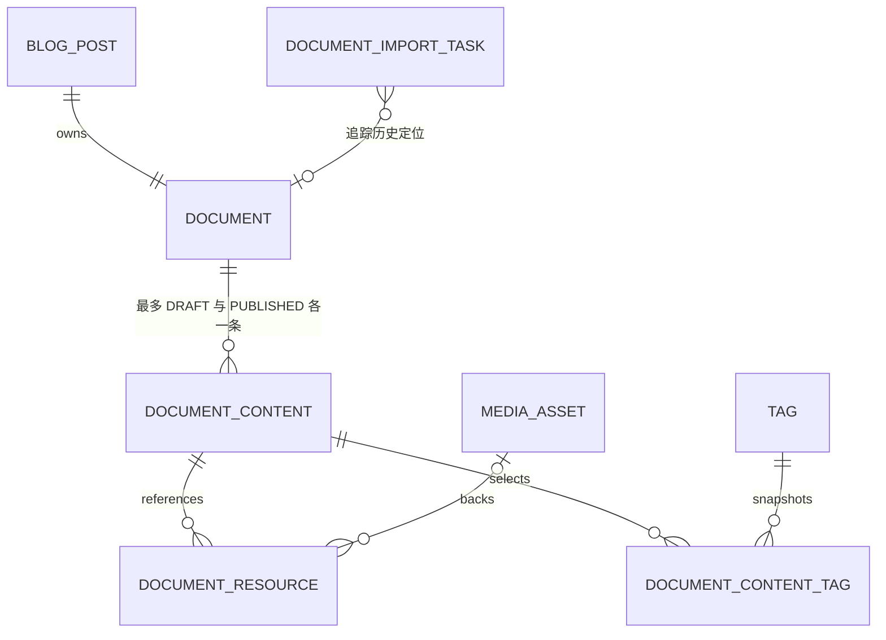
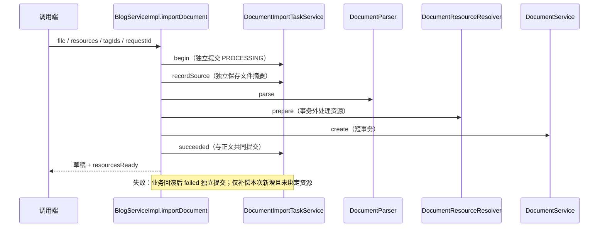
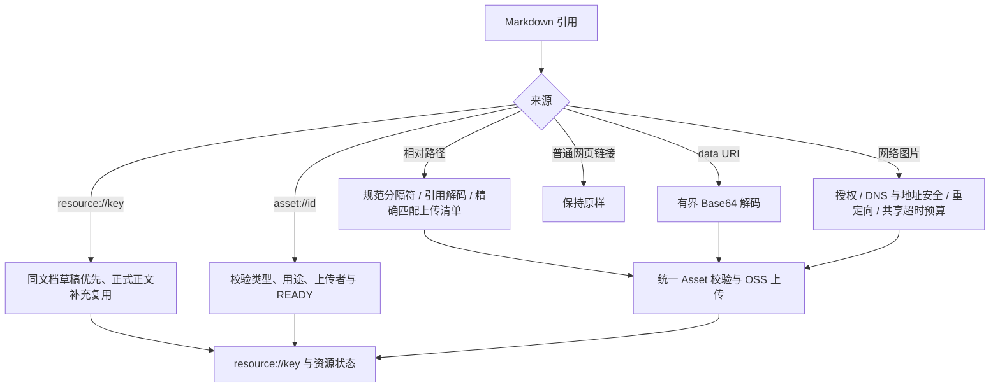
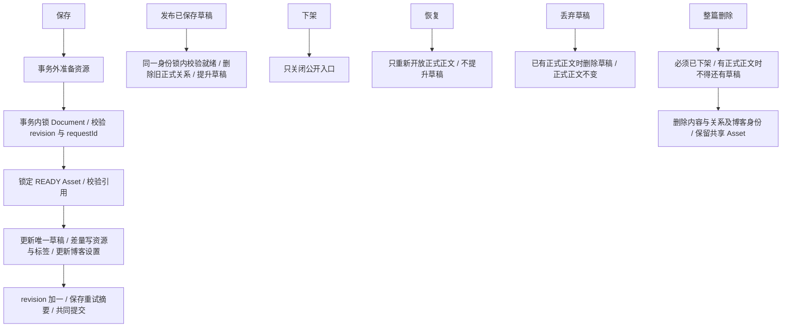
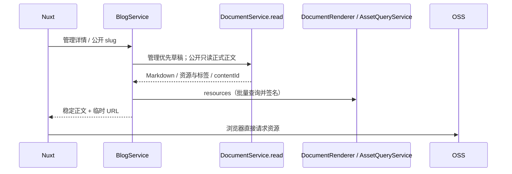
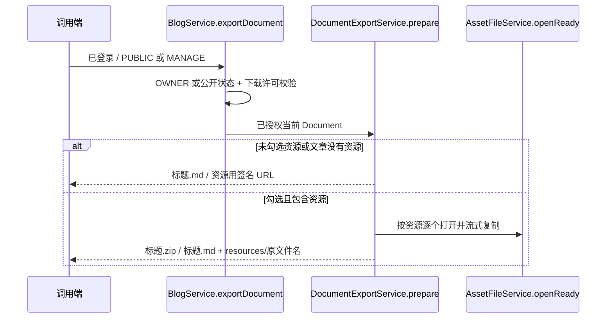

# 博客 Document 生命周期

当前只接入 UTF-8 Markdown。DOCX/PDF Parser、历史回滚及 RAG 均未启用。HTTP 契约见 [博客与 Document API](../api/blog-document.md)。

## 事实来源与边界

- `blog_post`：文章身份、固定 slug、公开状态、下载许可。
- `document`：文档身份及统一写修订 `revision`。
- `document_content`：最多一条 DRAFT、一条 PUBLISHED，正文仍是 Markdown。
- `document_resource`：当前内容的稳定 key、Asset、来源、状态及错误。
- `document_content_tag`：草稿/正式正文各自的 TOPIC、TECH 标签及名称快照。
- `media_asset`：真实文件名、类型、上传者和存储位置；文件字节在 OSS。
- `document_import_task`：同步导入来源、摘要、结果和问题记录；不承担异步调度。

原始上传文件、签名 URL、预览和导出文件不是正文真源。普通资源由浏览器直连 OSS；后端仅为受保护导出读取字节。

## 1. 总览

## 2. 数据关系

## 3. 导入

## 4. 资源路径与复用

## 5. 保存与状态动作

## 6. 展示

## 7. 导出

关系图中的线表示业务关联，不表示物理外键。唯一约束和查询索引仍保留，关联校验和删除边界由 Service 与事务负责。

## 核心代码阅读顺序

源码根包：`mai-portfolio-backend/mai-portfolio-modules/mai-portfolio-module-blog/mai-portfolio-module-blog-service/src/main/java/dev/amai/portfolio/blog/`。

| 类/方法 | 实际职责 |
| --- | --- |
| `BlogController` | HTTP 输入校验、权限声明、响应与流式导出接入 |
| `BlogServiceImpl.save/importDocument/persist` | 权限、标签校验、事务外资源准备、短事务提交和提交后投影 |
| `DocumentImportTaskServiceImpl.begin/recordSource/failed` | 独立事务保存来源/失败；不随正文回滚消失 |
| `DocumentImportTaskServiceImpl.succeeded` | 与 Blog、内容及关系同事务提交结果和资源问题 |
| `DocumentResourceResolver.prepare` | 校验正文、创建单次上下文、规范化引用、准备失败补偿 |
| `DocumentReferenceResolver.resolve` | 同类来源去重、稳定 key 和失败远程引用重试 |
| `DocumentResourceLoader.load/referencePath` | 来源识别、本地路径匹配、文件读取与统一上传调用 |
| `DocumentServiceImpl.beginWrite/persistDraft` | 身份行锁、修订检查、唯一草稿、资源/标签差量更新 |
| `DocumentServiceImpl.references` | 同文档正式资源补充、草稿优先的历史引用复用 |
| `BlogServiceImpl.transition/delete` | 发布、下架、恢复、丢弃草稿和整篇删除的业务边界 |
| `DocumentServiceImpl.publish/removeContent` | 原子提升草稿、清理旧关系；不物理删除共享文件 |
| `DocumentRenderer.resources/markdown` | 批量生成资源 URL，以及导出引用替换；不渲染或净化 HTML |
| `DocumentExportServiceImpl.prepare` | 选择 MD/ZIP、标题命名、平铺资源、流式输出 |

资源域的 `AssetQueryServiceImpl.lockReady` 在绑定事务内锁定 READY 元数据；`AssetFileServiceImpl.discardUnbound` 使用相同行锁，检查全部业务引用后才删除元数据，提交以后才清理 OSS。

## 路径与复用的关键细节

上传清单和正文引用都以 Markdown 所在目录为基准，例如正文写 `images/a.png`，上传资源名称也必须是 `images/a.png`。不会在服务器磁盘或用户电脑补找文件。

Windows 反斜杠会规范化；引用路径的百分号编码按引用边界解码，上传清单的文件名保留真实字符。绝对路径、目录越界、非法编码和重复路径明确报错，不按同名文件猜测。Base64 data URI 有独立大小与编码校验，真实图片仍经 Asset 解码/重编码；WebP 转为 PNG 后保留名称主体并纠正扩展名。

同一次准备按“资源类型 + 来源地址”去重；`resource://key` 只在当前文档的草稿和正式正文中复用；`asset://id` 校验上传者/用途后复用现有文件。重新导入同一目录不等于全局文件去重。

网络图片必须确认使用权，抓取经过 DNS、公网地址、重定向、容量和共享时间预算检查。普通网页链接原样保留。AST 替换保留未修改源码，代码块中的链接示例不参与归档；不递归解析附件中的 Markdown。

## 事务、并发与失败

1. 文件解析、远程抓取和 OSS 上传发生在数据库写事务之外。
2. 保存、发布、下架、恢复、丢弃草稿和删除共用 Document 身份行锁与 `revision`，过期请求返回 409。
3. 保存只更新工作草稿；标题、正文、资源和标签共同提交。公开内容直到发布才改变，下载许可保存后立即改变。
4. 发布校验已保存 slug、标题、正文和资源就绪，在同一事务中删除旧正式关系并提升草稿。恢复不提升草稿。
5. 单个资源失败允许保留草稿，返回 `resourcesReady=false` 和具体错误；不能发布，也不能宣称资源全部成功。
6. 整体失败只补偿本次新增且未绑定的资产。补偿持锁检查 Document、项目、账号头像和站点资料引用；不会误删共享资源。
7. PostgreSQL 回滚不会撤销 OSS。OSS 删除失败可能留下孤儿对象，仅安全记录日志；本轮没有引入后台回收器。
8. 内容已提交但管理预览签名失败时返回 `previewIssue`，不能提示重复保存。公开签名失败仍报错。
9. `requestId` 及请求摘要保护创建/最近写操作的重试；不是无限期请求日志。导入使用独立任务记录避免同一请求重复导入。
10. 导入进程异常退出可能留下 PROCESSING；需要核查结果，不能自动认定成功。本轮不引入恢复调度器。

## 迁移与扩展范围

V8 迁移旧指针选中的正式正文与当前草稿，保留选中内容及资源的 ID、正文和状态；其他历史版本不进入运行态。删除旧 role/alt_text、指针及版本表前必须有完整外部备份。共享 Asset 不在迁移中删除。

新增格式应扩展 Parser，仍复用当前资源准备、保存和导出主流程。不建立 RAG、Chunk、Embedding、MQ 或通用任务平台。未来检索从已持久化 Document 的正文/资源边界消费，不重新依赖原始文件。

图源码与本文同步维护于 [diagrams/document](diagrams/document/)；它们是同一说明的可编辑副本。
