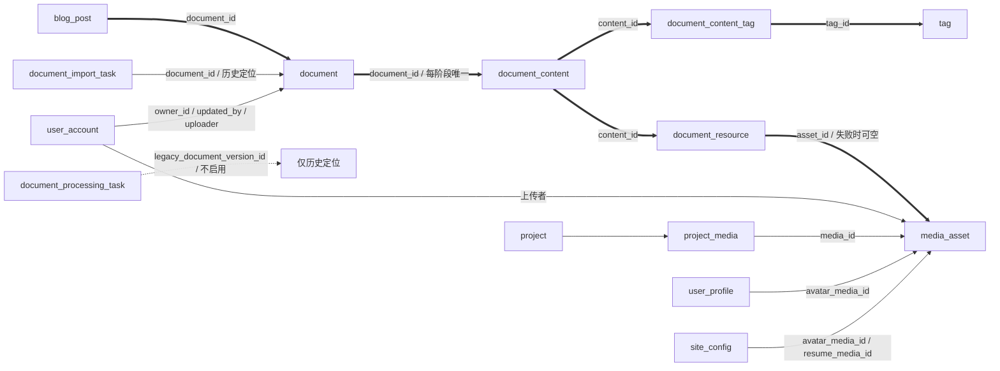

# 博客模块表结构与关系

[SQL 结构快照](blog-schema.sql) 对应 V1–V8，来自完整备份恢复后的隔离库，经真实 Flyway 升级。仅包含 public 下的 **14 张表、151 个字段及其全部注释**，没有业务数据。运行时唯一来源仍是[迁移目录](../../mai-portfolio-backend/mai-portfolio-launch/src/main/resources/db/postgresql/)；快照不代替初始化，不在已有数据库重复执行。此文不表示维护者的开发库已经升级。

## 核心表

| 表 | 职责 |
| --- | --- |
| **blog_post** | 博客身份、slug、公开状态、下载许可 |
| **document** | 文档身份、统一 revision、创建/最近请求的重试摘要 |
| **document_content** | DRAFT 与 PUBLISHED 各最多一条；Markdown、标题和摘要 |
| **document_resource** | content_id + resource_key 唯一，绑定 Asset 或保存失败状态 |
| **document_content_tag** | 内容标签选择及名称/slug/类别快照，随草稿发布 |
| **document_import_task** | 同步导入来源、摘要、问题和状态，不是后台调度器 |
| document_processing_task | 暂留的历史预留结构，未接入运行链路，旧版本 ID 仅历史定位 |

## 共享依赖

| 表 | 为什么与博客有关 |
| --- | --- |
| media_asset | 文件位置、原名、状态、用途和上传者；字节在 OSS |
| tag | TOPIC/TECH 共用目录，保存时批量校验 |
| user_account | 文档维护者和资源上传者 |
| user_profile | 头像可能共享 Asset，补偿前需检查 |
| site_config | 站点头像/简历可能引用 Asset，补偿前需检查 |
| project_media | 封面/图片可能共享 Asset，补偿前需检查 |
| project | project_media 的所属项目，结构快照需一并提供 |

## 关系图

**粗线表示博客当前内容核心关联**。这些核心关联由 Service、行锁和事务维护，不建立物理外键；不是没有关系。资源共享端保留既有外键，补偿保护不依赖它们报错。

实际物理外键可直接在 SQL 快照中检索 `FOREIGN KEY`；核心 Document/Blog/追踪结构没有外键。核心约束仍包括主键、文档阶段唯一、内容资源 key 唯一、内容标签唯一、创建/导入请求去重及必要索引。

## V8 迁移边界

- 保留旧 published_version_id 指向的正式正文；current_version_id 与其不同则保留为草稿。选中内容和资源的 ID、正文、来源、状态及错误不变。
- document_version、document_version_asset、document_version_tag 被当前内容结构替代，不保留双轨运行模型。
- 移除正文 role 和独立 alt_text，Markdown 内的图片替代文本保持不变；展示文件名来自 Asset 元数据。
- document_import_job 更名为 document_import_task 并接入真实记录。原有任务的未定义数值状态、旧版本 ID 明确作为 legacy 字段保留，不伪装成当前内容 ID。
- 未选中的旧历史快照只留在完整外部备份中；迁移前必须备份并演练。共享 Asset、账号、项目和站点数据不删除。
- 替换正文、丢弃草稿和整篇删除只清理所属关系，不自动删除文件。

升级和回退注意事项见[快速开始](../quickstart.md)；接口与状态动作见[博客契约](../api/blog-document.md)。
