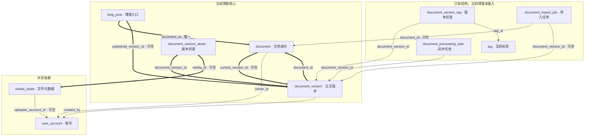

# 博客模块表结构与关系

## 文件与依据

- [完整 SQL 结构快照](blog-schema.sql)：PostgreSQL，包含建表、主键、外键、唯一约束、索引，以及全部 **10 张表、96 个字段**的数据库注释，不包含业务数据。
- 导出依据：2026-10-20 的 `origin/dev`，Commit `9b015055231eb0735f3d0fab8d6460f4e6bd3e84`；与后端 `backend` 同步。相关结构由 V1–V7 迁移形成。
- [运行时迁移](../../mai-portfolio-backend/mai-portfolio-launch/src/main/resources/db/postgresql/)仍是 Schema 的唯一来源。快照用于阅读和独立空 schema，不加入 Flyway，不代替完整项目初始化，也不在已有业务 schema 重复执行。
- 这是一份依据代码迁移整理的结构导出，没有连接运行中的数据库；本机数据库若被手工改过，不代表已经包含在本文件中。

## 哪些表正在使用

| 分类 | 表 | 职责及当前使用情况 |
| --- | --- | --- |
| 当前核心 | `blog_post` | 博客入口、slug、公开状态、下载开关、公开版本指针；不保存第二份正文 |
| 当前核心 | `document` | 文档身份、所有者、最新保存版本指针、乐观锁 |
| 当前核心 | `document_version` | 每次保存产生的不可变正文、标题、摘要等快照 |
| 当前核心 | `document_version_asset` | 此版本的图片/附件引用、稳定 key、来源、处理状态、失败原因 |
| 共享依赖 | `user_account` | 文档所有者、版本创建者和资源上传者的账号 |
| 共享依赖 | `media_asset` | 文件存储键、名称、大小、类型、状态、用途、上传者；实际文件在 OSS |
| 共享标签目录 | `tag` | 全局标签；已有数据库结构和 System 模块能力，当前博客未接入标签保存 |
| 已有但未接入 | `document_version_tag` | 某一正文版本的标签名称、slug 快照；当前博客没有对应读写 |
| 已有但未接入 | `document_import_job` | 导入任务记录；当前 Markdown 导入直接同步保存 Document，不写此表 |
| 已有但未接入 | `document_processing_task` | 异步任务和重试字段；当前博客没有对应任务链路 |

后 4 行保留是为了完整说明已有博客相关结构，不表示已经实现博客标签、导入任务调度、异步处理或 RAG。本次没有启用、删除或修改这些表。

不包含 `site_config`、`user_profile`、`project`、`project_link`、`project_tag`、`project_media`：它们属于站点资料、账号资料或项目展示，当前博客的正文/版本/资源持久化不依赖这些表。账号表、资源表、标签表是共享表，已完整导出，没有裁剪字段。

## 表关系图

**箭头从“持有外键的表”指向“被引用的表”**，连线文字为外键字段。**粗线突出博客、文档、版本及文件之间的核心关联**，细线表示账号及其他关联。图中全部 14 条连线都对应真实数据库外键；“可空”表示该关联允许尚未建立。



### 外键与关系明细

| 外键字段 | 关联目标 | 可空 | 关系说明 |
| --- | --- | --- | --- |
| `blog_post.document_id` | `document.id` | 否 | 有唯一约束：一篇博客对应一份文档，一份文档最多对应一篇博客 |
| `blog_post.published_version_id` | `document_version.id` | 是 | 公开版本指针，首次发布前为空；属于本博客文档的规则由 Service 校验 |
| `document.current_version_id` | `document_version.id` | 是 | 最新保存版本指针；新文档创建过程中可先为空，指针归属由 Service 保证 |
| `document.owner_id` | `user_account.id` | 否 | 一个账号可拥有多份文档 |
| `document_version.document_id` | `document.id` | 否 | 一份文档有多个版本；`(document_id, version_number)` 唯一 |
| `document_version.created_by` | `user_account.id` | 否 | 一个账号可创建多个正文版本 |
| `document_version_asset.document_version_id` | `document_version.id` | 否 | 一个版本有多条资源引用；`(document_version_id, resource_key)` 唯一 |
| `document_version_asset.media_id` | `media_asset.id` | 是 | 一个文件可被多个版本引用；尚未归档成功的资源可以没有 Asset |
| `media_asset.uploader_account_id` | `user_account.id` | 是 | 一个账号可上传多个文件；历史文件可能无法确定上传者 |
| `document_version_tag.document_version_id` | `document_version.id` | 否 | 一个版本有多个标签快照 |
| `document_version_tag.tag_id` | `tag.id` | 否 | 一个标签可被多个版本引用；同版本与标签组合唯一 |
| `document_import_job.document_id` | `document.id` | 是 | 尚未生成文档的导入记录允许为空 |
| `document_import_job.document_version_id` | `document_version.id` | 是 | 尚未生成版本的导入记录允许为空 |
| `document_processing_task.document_version_id` | `document_version.id` | 否 | 一个版本可以关联多个处理任务 |

全部外键使用 `ON DELETE RESTRICT`，不自动级联删除。除上述唯一约束外，两个版本指针没有“本指针必须属于本行文档”的数据库复合外键；不能把应用层归属校验误认为数据库已有同等约束。

## 读懂核心业务

### 保存、发布和下架是三件事

```text
保存草稿：
  新增 document_version
  → 写入这个版本的 document_version_asset
  → document.current_version_id 指向新版本

显式发布：
  校验当前版本和资源
  → blog_post.published_version_id 指向这个版本
  → blog_post.status = 1

下架：
  blog_post.status = 0
  → 公开入口不再展示文章，普通已签发资源链接不要求立即失效
```

- 管理端读取 `document.current_version_id`；公开端检查博客已发布，并读取 `blog_post.published_version_id`。保存新草稿不会自动改变公开正文。
- `document.lock_version` 是并发修改的乐观锁计数，`document_version.version_number` 是正文快照版本号，含义不同。发布/下架也会推进锁计数。
- `document` 与 `document_version` 双向指针属于正常的“身份 → 当前快照 / 快照 → 身份”结构，不代表正文附件递归。

### 正文怎样找到图片和附件

```text
document_version.markdown_content 中的 resource://key
  → document_version_asset（相同 version_id + resource_key）
  → media_id
  → media_asset.id
  → storage_key
  → OSS 文件
```

- `resource_key` 允许在同一文档不同版本中复用；只在“版本 + key”范围唯一，并不是所有文档全局唯一。
- `media_id` 不唯一，多个版本可以指向同一个已上传文件；失败引用可为 NULL，并保留来源、状态和错误摘要。
- OSS 签名 URL 是查询/展示时派生的临时访问地址，不是正文和数据库关系的事实来源。
- 资源状态码与 Asset 状态码不能混用：`document_version_asset.status` 为 `0=READY、1=FETCH_FAILED、2=INVALID`；`media_asset.status` 为 `0=PENDING、1=READY、2=FAILED`。
- 原始来源在数据库字段 `source_reference` 中，对应当前 Java 的 `originalUri`；数据库列名 `media_id` 对应当前 Java 的 `assetId`。

## 数据库历史注释与当前实现的区别

SQL 中的 `COMMENT ON` 忠实保留 V1–V7 最后一次迁移写入的注释，没有借导出修改线上 Schema。阅读时注意以下历史措辞：

- V1 的 `markdown_content` 注释仍写 `asset://`；当前持久化正文实际使用 `resource://key`，由 V5 引入的版本资源关系解析。`asset://id` 可作为编辑输入，但会在保存准备阶段转为稳定资源引用。
- `media_asset.original_filename` 的旧注释写“仅用于展示与审计”；当前它也用于附件下载和 ZIP 导出的文件命名。
- `document_version_asset.media_id` 已由 V5 改成可空；V5、V7 的最终注释和字段状态已合并到快照，不能只看 V1 判断。
- 标签快照和两张任务表的注释描述了早期设计意图；当前对应功能的使用状态以本文件表格为准。

后续 Schema 变更仍应新增 Flyway 迁移；需要重新导出时按新的迁移重建本快照，不在这里单独维护另一套运行规则。
