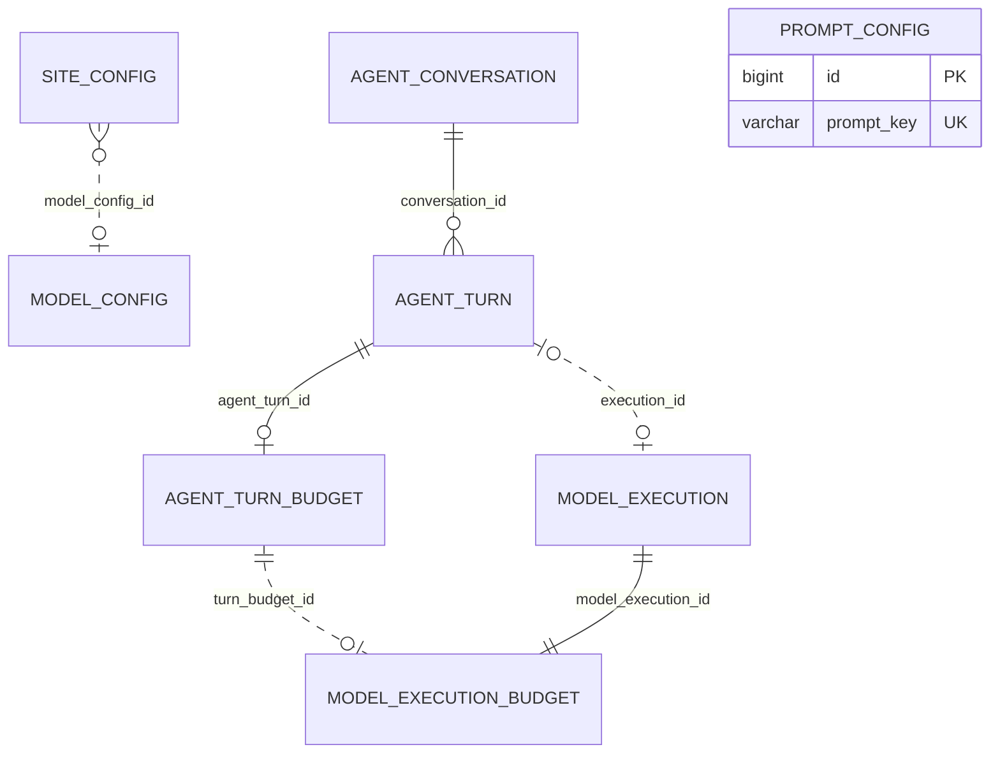
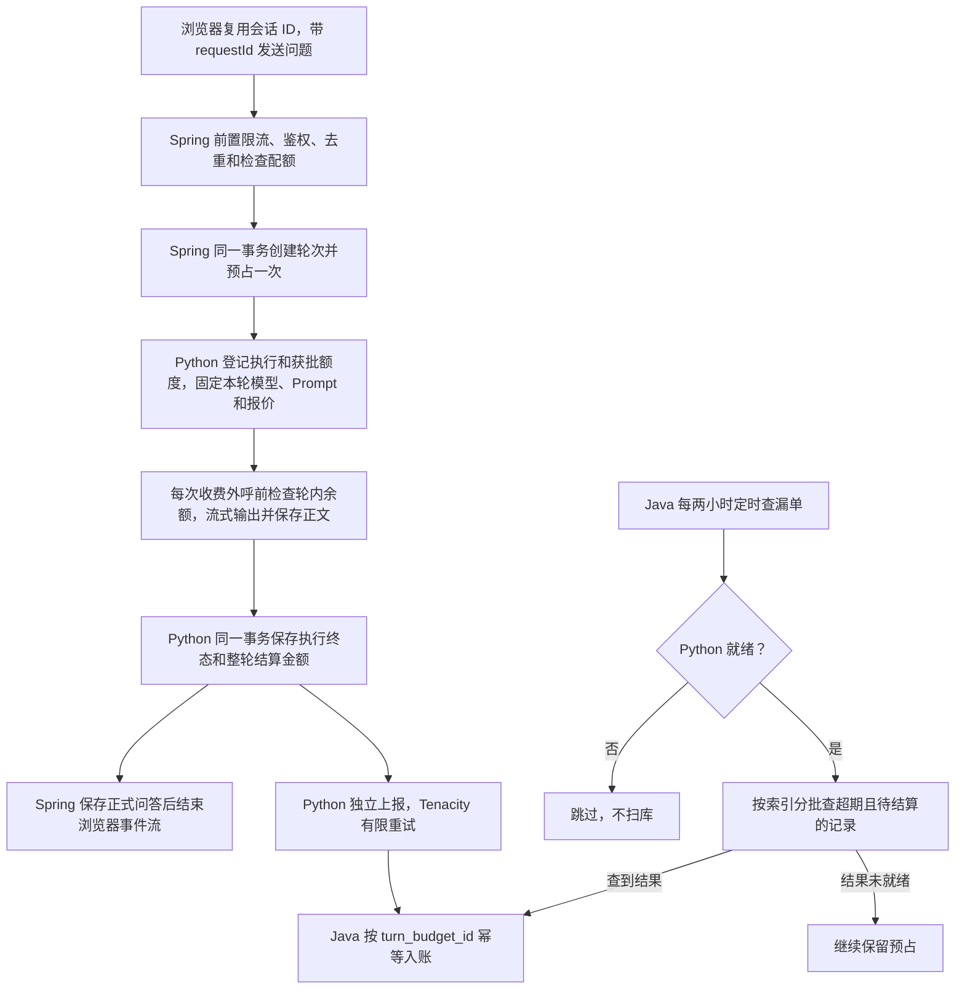

# 数字人数据库整改审核稿 v1

上一轮对话中的送审方案，作为版本比较基线。从 v2 起以 [当前审核稿](site-guide-schema.md) 为准。本文中的 SQL 是目标结构，未执行。

## 职责和表关系

Java 管网站会话、正式问答、配置和每日预算。Python 管模型配置、Prompt、执行快照和整轮金额。Java 每轮预占一次，Python 主动结算，失败时有限重试，Java 每两小时兜底。无需人工对账、逐次外呼账本、价格版本或持久化模型配置快照。



## Java PostgreSQL

### site_config

唯一站点运行配置。个人资料移到前端，SEO 保留在此版基线。

```sql
CREATE TABLE site_config (
    id                         bigint GENERATED ALWAYS AS IDENTITY PRIMARY KEY, -- 站点配置编号
    seo_title                  varchar(200), -- 站点 SEO 标题
    seo_description            varchar(500), -- 站点 SEO 摘要
    agent_enabled              boolean NOT NULL DEFAULT false, -- 是否开放数字人
    model_config_id            bigint, -- Python 模型配置编号，空时使用有效默认配置
    model_budget_daily_limit   numeric(20, 6) NOT NULL DEFAULT 0
                               CHECK (model_budget_daily_limit >= 0), -- 每日金额上限，零暂停付费调用
    model_budget_turn_limit    numeric(20, 6) NOT NULL
                               CHECK (model_budget_turn_limit > 0), -- 每轮金额上限
    model_budget_unlimited     boolean NOT NULL DEFAULT false, -- 是否关闭每日上限，仍保留单轮上限
    model_budget_currency      smallint NOT NULL DEFAULT 1
                               CHECK (model_budget_currency IN (1, 2)), -- 1 人民币，2 美元
    global_window_hours        integer NOT NULL CHECK (global_window_hours > 0), -- 全站滚动窗口小时数
    global_request_limit       integer NOT NULL CHECK (global_request_limit > 0), -- 窗口内最多受理轮次
    visitor_daily_turn_limit   integer NOT NULL CHECK (visitor_daily_turn_limit > 0), -- 访客滚动 24 小时轮次
    account_daily_turn_limit   integer NOT NULL CHECK (account_daily_turn_limit > 0), -- 账号滚动 24 小时轮次
    updated_at                 timestamptz NOT NULL DEFAULT now() -- Spring 最近保存时间
);
CREATE UNIQUE INDEX site_config_single_row_idx ON site_config ((true));
COMMENT ON TABLE site_config IS '本站唯一的 SEO、数字人开关、模型选择和预算配额配置';
```

### agent_conversation

站点会话。一位匿名访客一个会话，登录账号可有多个会话。历史导入按所有者和导入标识防重。

```sql
CREATE TABLE agent_conversation (
    id         bigint GENERATED ALWAYS AS IDENTITY PRIMARY KEY, -- 浏览器保存并用于恢复的会话编号
    owner_key  varchar(100) NOT NULL, -- Spring 生成和核验的账号或访客归属键
    anonymous  boolean NOT NULL, -- 是否为匿名会话
    import_id  varchar(36), -- 客户端导入去重标识，普通会话为空
    updated_at timestamptz NOT NULL DEFAULT now(), -- 最近活动时间，用于列表排序及游标
    UNIQUE (owner_key, import_id)
);
CREATE UNIQUE INDEX agent_conversation_anonymous_owner_idx
    ON agent_conversation (owner_key) WHERE anonymous;
CREATE INDEX agent_conversation_owner_activity_idx
    ON agent_conversation (owner_key, updated_at DESC, id DESC);
COMMENT ON TABLE agent_conversation IS '网站会话，保存所有者、导入标识和最近活动时间';
```

### agent_turn

正式问答。原 ordinal 改名为 id 并升为主键，仍承担会话内的轮次顺序。

```sql
CREATE TABLE agent_turn (
    id              bigint GENERATED ALWAYS AS IDENTITY PRIMARY KEY, -- 原 ordinal，轮次主键及排序
    conversation_id bigint NOT NULL, -- 所属网站会话
    request_id      varchar(36) NOT NULL UNIQUE, -- 浏览器请求重试去重，关联 Python 请求
    execution_id    bigint UNIQUE, -- Python 执行编号，未绑定或历史导入时为空
    question        text NOT NULL, -- 用户问题
    answer          text NOT NULL DEFAULT '', -- 网站正式保存的回答
    status          smallint NOT NULL DEFAULT 0
                    CHECK (status IN (0, 1, 3, 4, 5)), -- 0 待受理，1 已受理，3 已完成，4 失败，5 已中断
    error_code      varchar(80), -- 网站业务错误码，无错误时为空
    accept_before   timestamptz NOT NULL, -- Python 首次受理截止时间，导入时取导入时间
    quota_at        timestamptz, -- 计入轮次额度的受理时间，历史导入为空
    created_at      timestamptz NOT NULL DEFAULT now() -- 网站创建时间
);
CREATE INDEX agent_turn_conversation_order_idx ON agent_turn (conversation_id, id);
CREATE UNIQUE INDEX agent_turn_active_conversation_idx
    ON agent_turn (conversation_id) WHERE status IN (0, 1);
CREATE INDEX agent_turn_quota_time_idx ON agent_turn (quota_at) WHERE quota_at IS NOT NULL;
CREATE INDEX agent_turn_quota_conversation_time_idx
    ON agent_turn (conversation_id, quota_at) WHERE quota_at IS NOT NULL;
COMMENT ON TABLE agent_turn IS '网站保存的正式问答轮次和面向用户的执行状态';
```

### agent_turn_budget

Java 正式整轮预算账本。一轮一次预占，同一预算编号幂等结算。

```sql
CREATE TABLE agent_turn_budget (
    id              bigint GENERATED ALWAYS AS IDENTITY PRIMARY KEY, -- 跨服务结算键
    agent_turn_id   bigint NOT NULL UNIQUE, -- Java 轮次编号
    billing_day     date NOT NULL, -- Asia/Shanghai 预占归属日，跨零点归入原日
    currency        smallint NOT NULL CHECK (currency IN (1, 2)), -- 1 人民币，2 美元
    reserved_amount numeric(20, 6) NOT NULL CHECK (reserved_amount > 0), -- 一次批准的额度
    settled_amount  numeric(20, 6), -- 最终计入预算金额，确认零费用时为零
    status          smallint NOT NULL DEFAULT 0 CHECK (status IN (0, 1)), -- 0 待结算，1 已结算
    created_at      timestamptz NOT NULL DEFAULT now(), -- 预占时间，用于查超期未结算记录
    settled_at      timestamptz, -- Java 正式入账时间
    CHECK (settled_amount BETWEEN 0 AND reserved_amount),
    CHECK (
        (status = 0 AND settled_amount IS NULL AND settled_at IS NULL)
        OR (status = 1 AND settled_amount IS NOT NULL AND settled_at IS NOT NULL)
    )
);
CREATE INDEX agent_turn_budget_daily_idx ON agent_turn_budget (billing_day, currency);
CREATE INDEX agent_turn_budget_pending_idx ON agent_turn_budget (created_at, id) WHERE status = 0;
COMMENT ON TABLE agent_turn_budget IS 'Java 正式预算账本，保存每轮预占和最终计入金额';
```

## Python PostgreSQL

### model_config

一条记录是一套 Chat 和 Embedding 配置，可启用多套，最多一套默认。

```sql
CREATE TABLE model_config (
    id                                bigint GENERATED ALWAYS AS IDENTITY PRIMARY KEY, -- 模型配置编号
    name                              varchar(100) NOT NULL UNIQUE, -- 配置中心展示名称
    is_active                         boolean NOT NULL DEFAULT false, -- 是否允许用于新执行
    is_default                        boolean NOT NULL DEFAULT false, -- 未指定配置时是否优先使用
    revision                          bigint NOT NULL DEFAULT 0 CHECK (revision >= 0), -- 防止覆盖过期编辑
    model_provider                    varchar(100) NOT NULL, -- 供应商接口协议类型
    model_timeout_seconds             integer NOT NULL CHECK (model_timeout_seconds > 0), -- 单次超时秒数
    currency                          smallint NOT NULL CHECK (currency IN (1, 2)), -- 报价币种
    chat_base_url                     text NOT NULL, -- 对话 API 基础地址
    chat_api_key_encrypted            text, -- 加密对话凭证
    chat_model                        varchar(200) NOT NULL, -- 对话模型名称
    chat_max_output_tokens            integer NOT NULL CHECK (chat_max_output_tokens > 0), -- 对话最大输出
    chat_billable_input_limit         integer NOT NULL CHECK (chat_billable_input_limit >= 0), -- 输入计价上界
    chat_input_price_per_million      numeric(24, 12) NOT NULL CHECK (chat_input_price_per_million >= 0), -- 百万输入单价
    chat_output_price_per_million     numeric(24, 12) NOT NULL CHECK (chat_output_price_per_million >= 0), -- 百万输出单价
    embedding_base_url                text, -- 向量 API 基础地址
    embedding_api_key_encrypted       text, -- 加密向量凭证
    embedding_model                   varchar(200), -- 向量模型名称
    embedding_dimensions              integer CHECK (embedding_dimensions > 0), -- 向量维度，空为模型默认
    embedding_billable_input_limit    integer NOT NULL DEFAULT 0 CHECK (embedding_billable_input_limit >= 0), -- 输入计价上界
    embedding_input_price_per_million numeric(24, 12) CHECK (embedding_input_price_per_million >= 0), -- 百万输入单价
    updated_at                        timestamptz NOT NULL DEFAULT now(), -- Python 最近保存时间
    CHECK (NOT is_default OR is_active)
);
CREATE UNIQUE INDEX model_config_default_idx ON model_config (is_default) WHERE is_default;
COMMENT ON TABLE model_config IS 'Python 管理的可编辑模型连接参数和每百万 Token 报价';
```

### prompt_config

按用途独立管理提示词，例如 persona。

```sql
CREATE TABLE prompt_config (
    id         bigint GENERATED ALWAYS AS IDENTITY PRIMARY KEY, -- 提示词配置编号
    prompt_key varchar(64) NOT NULL UNIQUE, -- 工作流读取的稳定用途键
    content    text NOT NULL CHECK (btrim(content) <> ''), -- 当前生效的正文
    updated_at timestamptz NOT NULL DEFAULT now() -- 最近保存时间
);
COMMENT ON TABLE prompt_config IS '按用途独立管理的提示词配置';
```

### model_execution

Python 执行状态和流式恢复正文。Python 终态正文保留一天，到期清空正文，Java 正式问答独立保留。

```sql
CREATE TABLE model_execution (
    id          bigint GENERATED ALWAYS AS IDENTITY PRIMARY KEY, -- Python 执行编号
    request_id  uuid NOT NULL UNIQUE, -- 对应 Java 请求的幂等标识
    input_hash  text NOT NULL, -- 检查同一请求是否换了业务输入
    status      smallint NOT NULL DEFAULT 0 CHECK (status IN (0, 1, 2, 3, 4)), -- 0 已受理，1 运行中，2 完成，3 失败，4 中断
    text        text NOT NULL DEFAULT '', -- 用于断线恢复的已生成正文
    error       text, -- 执行错误码
    created_at  timestamptz NOT NULL DEFAULT now(), -- 执行登记时间
    finished_at timestamptz, -- 执行进入终态时间
    CHECK ((status IN (2, 3, 4)) = (finished_at IS NOT NULL))
);
CREATE INDEX model_execution_pending_cleanup_idx ON model_execution (finished_at, id)
    WHERE finished_at IS NOT NULL AND text <> '';
COMMENT ON TABLE model_execution IS 'Python 模型执行状态和用于流式恢复的临时正文';
```

### model_execution_budget

Python 保存整轮获批额度和可重复上报的结果，与执行一起创建。

```sql
CREATE TABLE model_execution_budget (
    id                 bigint GENERATED ALWAYS AS IDENTITY PRIMARY KEY, -- Python 整轮预算记录编号
    model_execution_id bigint NOT NULL UNIQUE, -- 所属 Python 执行
    turn_budget_id     bigint NOT NULL UNIQUE, -- Java 预算编号
    approved_amount    numeric(20, 6) NOT NULL CHECK (approved_amount > 0), -- 本轮获批金额
    currency           smallint NOT NULL CHECK (currency IN (1, 2)), -- 1 人民币，2 美元
    budget_used_amount numeric(20, 6), -- 最终计入本站预算的金额
    status             smallint NOT NULL DEFAULT 0 CHECK (status IN (0, 1)), -- 0 待生成，1 结果已生成
    CHECK (budget_used_amount BETWEEN 0 AND approved_amount),
    CHECK (
        (status = 0 AND budget_used_amount IS NULL)
        OR (status = 1 AND budget_used_amount IS NOT NULL)
    )
);
COMMENT ON TABLE model_execution_budget IS 'Python 的整轮获批额度和可重复上报的预算结算结果';
```

## 一轮对话



获批额度按预占归属日计算。Spring 在数据库短事务内完成当日余额校验和预占，事务外调用 Python。Python 使用配置的最高适用价格和输入输出上界核算，按六位小数向上取整。用量无法确认时按批准额度计入，结算恢复只查已保存的整轮金额。查账 RPC 临时失败使用 Spring Retry。金额空值仅由数据库检查状态一致性，业务直接读取状态枚举。

## 基线迁移

保留旧会话和问答，用迁移映射填充整数关联，ordinal 直接升为 Java 轮次主键，保留 request_id 和 import_id。前端迁移静态资料并切换旧媒体公开判断。Python 将模型参数和密文迁入 model_config，将 persona 迁入 prompt_config。切换前停收付费轮次，让旧执行和待上报账目收尾，承接当日可验证预算占用。旧运行表退出，切换不靠长期兼容层。旧迁移不改写，以新增 Flyway 和 Alembic 迁移实现。
