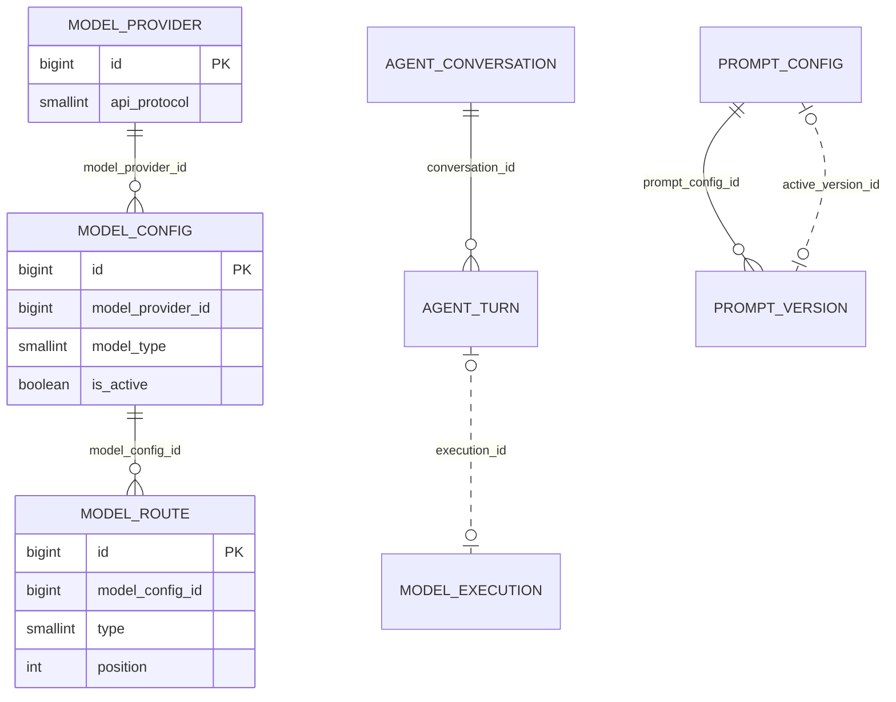
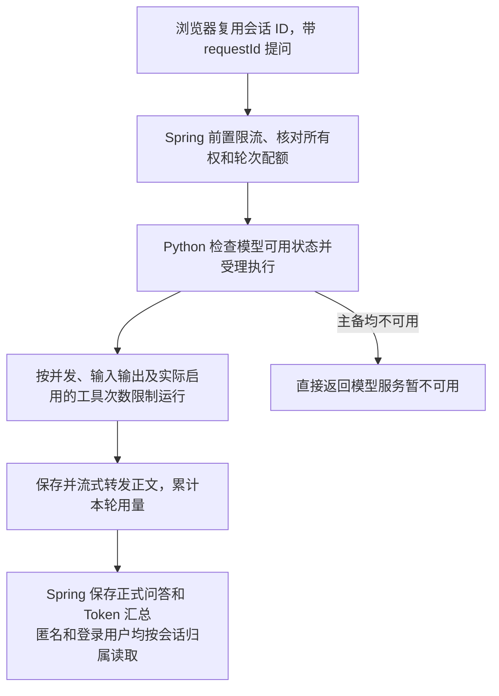

# 数字人数据库整改审核稿 v3

[上一轮设计基线 v1](site-guide-schema-v1.md)。本文汇总最新目标表、关联和对话流程。本轮全部相关字段经维护者确认后，再编写迁移、实体及处理逻辑。

## 首发表结构范围

| 范围 | 首发设计 | 后续安排 |
| --- | --- | --- |
| 模型配置与路由 | 供应商接入、模型目录与执行链分别保存。模型配置只保存调用参数。Chat 和 Embedding 各有独立路由，启用与入链分开。 | 候选暂时不可用由 Python 在运行时处理。 |
| 每轮 Token | 保存每轮问答的输入、输出 Token 和用量状态。 | 用量看板待需求明确后另行设计。 |

## 页面 SEO 的现状

当前 Nuxt 前端没有读取 `site_config.seo_title` 或 `site_config.seo_description`。公开资料接口响应也不包含这两个属性。

| 页面 | 当前 SEO 来源 |
| --- | --- |
| [首页](../../mai-portfolio-frontend/app/pages/index.vue#L34) | 页面标题和首页简介 `HOME_INTRO`。 |
| [项目页](../../mai-portfolio-frontend/app/pages/projects.vue#L21) | 项目页自己定义的标题和摘要。 |
| [博客列表](../../mai-portfolio-frontend/app/pages/blog/index.vue#L69) | 博客列表页面自己的标题和摘要。 |
| [博客详情](../../mai-portfolio-frontend/app/pages/blog/%5Bslug%5D.vue#L38) | 当前文章的标题和摘要。 |

[usePortfolioSeo](../../mai-portfolio-frontend/app/composables/usePortfolioSeo.ts#L19) 统一生成这些页面的元信息。SEO 继续走这条独立链路，`site_config` 删除两列，不引入新的数据库依赖。

## 职责和表关系

Java 管网站会话、匿名和登录用户的正式问答、站点配置和聊天接口限流。Python 管模型配置、Prompt 版本、执行、每轮 Token 记录、多模型路由和供应商可用性。浏览器仅保存匿名会话 ID，登录后 Spring 自动转移原会话归属。本站移除每日金额门禁及首拨、补拨、预占和退款流程。运营侧按需查看供应商钱包余额。余额提醒由供应商原生功能负责。



## Java PostgreSQL

### site_config

移除组合配置引用，Chat 和 Embedding 的主备模型选择由 Python 负责。

唯一站点运行配置。个人轮次按滚动 24 小时计算，匿名默认 10 轮、登录账号默认 30 轮。个人资料移到前端。页面 SEO 由各自的 Nuxt 页面或页面内容管理。

```sql
CREATE TABLE site_config (
    id                         bigint GENERATED ALWAYS AS IDENTITY PRIMARY KEY, -- 站点配置编号
    agent_enabled              boolean NOT NULL DEFAULT false, -- 是否开放数字人
    global_window_hours        integer NOT NULL CHECK (global_window_hours > 0), -- 全站滚动窗口小时数
    global_request_limit       integer NOT NULL CHECK (global_request_limit > 0), -- 窗口内最多受理轮次
    visitor_daily_turn_limit   integer NOT NULL CHECK (visitor_daily_turn_limit > 0), -- 访客滚动 24 小时轮次
    account_daily_turn_limit   integer NOT NULL CHECK (account_daily_turn_limit > 0), -- 账号滚动 24 小时轮次
    updated_at                 timestamptz NOT NULL DEFAULT now() -- Spring 最近保存时间
);
CREATE UNIQUE INDEX site_config_single_row_idx ON site_config ((true));
COMMENT ON TABLE site_config IS '本站唯一的数字人开关和轮次配额配置';
```

### agent_conversation

站点会话。一位匿名访客有一个会话，登录账号可有多个会话。登录时 Spring 核验登录账号、有效访客 Cookie 及原会话归属，原子更新 `owner_key` 与 `anonymous`，保留会话 `id` 以及关联问答。重复转给同一账号返回原会话，禁止转移已归属其他账号的会话。

创建时使用同一个时间值写入 `created_at` 并生成默认标题。标题格式为「新会话 + 上海时间」，例如 `新会话 2026-11-17 14:30:25`。收到首问后，仍为默认标题时用首问正文生成标题，最多 25 个字符。用户已修改的标题保持原值。

旧会话已有标题和创建时间时沿用。仓库旧版 `agent_conversation` 没有这两列：创建时间优先使用首轮的 `created_at`，无轮次时使用原 `updated_at`。它们是历史回填值。标题优先取首问正文（最多 25 个字符），无首问时按回填的创建时间生成默认标题。

```sql
CREATE TABLE agent_conversation (
    id         bigint GENERATED ALWAYS AS IDENTITY PRIMARY KEY, -- 浏览器保存并用于恢复的会话编号
    title      varchar(25)  NOT NULL,  -- 创建时为新会话加创建时间，之后可由首问生成或手动修改
    owner_key  varchar(100) NOT NULL, -- Spring 生成和核验的账号或访客归属键
    anonymous  boolean NOT NULL, -- 是否为匿名会话
    created_at timestamptz NOT NULL DEFAULT now(), -- 会话创建时间
    updated_at timestamptz NOT NULL DEFAULT now() -- 最近活动时间，用于列表排序及游标
);
CREATE UNIQUE INDEX agent_conversation_anonymous_owner_idx
    ON agent_conversation (owner_key) WHERE anonymous;
CREATE INDEX agent_conversation_owner_activity_idx
    ON agent_conversation (owner_key, updated_at DESC, id DESC);
COMMENT ON TABLE agent_conversation IS '网站会话，保存所有者、匿名标记和最近活动时间';
```

### agent_turn

保存匿名和登录用户的正式问答。登录后只更新会话归属，已有问答仍关联原 `conversation_id`。轮次计数和限流沿用现行需求。原 `ordinal` 改名为 `id` 并升为主键，仍承担会话内的轮次顺序。`error_mes` 只保存可对用户展示的报错信息，例如「模型服务暂不可用」。服务间错误码与 API 错误契约各按原职责处理。

```sql
CREATE TABLE agent_turn (
    id              bigint GENERATED ALWAYS AS IDENTITY PRIMARY KEY, -- 原 ordinal，轮次主键及排序
    conversation_id bigint NOT NULL, -- 所属网站会话
    request_id      varchar(36) NOT NULL UNIQUE, -- 浏览器请求重试去重，关联 Python 请求
    execution_id    bigint UNIQUE, -- Python 执行编号，未绑定或历史导入时为空
    question        text NOT NULL, -- 用户问题
    answer          text NOT NULL DEFAULT '', -- 网站正式保存的回答
    status          smallint NOT NULL DEFAULT 0
                    CHECK (status IN (0, 1, 3, 4, 5)), -- 0 待受理，1 已受理，3 已完成，4 失败，5 已中断
    error_mes       text, -- 可供网站展示的业务错误信息，无错误时为空
    input_tokens    bigint CHECK (input_tokens >= 0), -- 本轮已知输入 Token 总数
    output_tokens   bigint CHECK (output_tokens >= 0), -- 本轮已知输出 Token 总数
    usage_status    smallint NOT NULL DEFAULT 0 CHECK (usage_status IN (0, 1, 2, 3)), -- 用量状态
    accept_before   timestamptz NOT NULL, -- Python 首次受理截止时间，导入时取导入时间
    quota_at        timestamptz, -- 计入轮次额度的受理时间，历史导入为空
    is_deleted      boolean NOT NULL DEFAULT false, -- 清空后隐藏本轮，保留原问答与计次记录
    created_at      timestamptz NOT NULL DEFAULT now(), -- 轮次创建时间
    CHECK (
        (usage_status IN (0, 3) AND input_tokens IS NULL AND output_tokens IS NULL)
        OR (usage_status = 1 AND input_tokens IS NOT NULL AND output_tokens IS NOT NULL)
        OR (usage_status = 2 AND (input_tokens IS NOT NULL OR output_tokens IS NOT NULL))
    )
);
CREATE INDEX agent_turn_conversation_order_idx ON agent_turn (conversation_id, id);
CREATE UNIQUE INDEX agent_turn_active_conversation_idx
    ON agent_turn (conversation_id) WHERE status IN (0, 1);
CREATE INDEX agent_turn_quota_time_idx ON agent_turn (quota_at) WHERE quota_at IS NOT NULL;
CREATE INDEX agent_turn_quota_conversation_time_idx
    ON agent_turn (conversation_id, quota_at) WHERE quota_at IS NOT NULL;
COMMENT ON TABLE agent_turn IS '网站保存的正式问答轮次和面向用户的执行状态';
```

## Python PostgreSQL

### 供应商接入、模型目录和执行链

三张表及字段注释以 backend 工作区的 `private/agent-design/model-config-review.sql` 为准。

| 表 | 职责 |
| --- | --- |
| `model_provider` | 一行是一张管理员创建的接入卡片，保存卡片标题 `title`、供应商标识、接口协议、API 地址、加密凭证和可选的钱包别名。后台读取只返回是否已配置凭证。 |
| `model_config` | 一行是卡片下的一个模型，保存供应商模型 ID `model_key`、显示名称 `model_nickname`、能力类型、启用状态和按类型校验的 JSONB 参数。 |
| `model_route` | 分开保存各业务链的候选和顺序。模型启用后可以显式入链。序号 1 是主配置，其余按序尝试。 |

| `smallint` 字段 | 首发枚举 |
| --- | --- |
| `model_provider.api_protocol` | `1` OpenAI 兼容协议。Chat 使用 LangChain 的 `ChatOpenAI`，Embedding 使用 `OpenAIEmbeddings`。 |
| `model_config.model_type` | `1` Chat，`2` Embedding。 |
| `model_route.type` | `1` Chat 回复，`2` Embedding 向量化。保存链时按用途校验模型能力。 |

Python 负责用枚举选择 LangChain 集成，并传入接入地址、凭证和模型参数。请求和响应的协议适配由 LangChain 处理。后续接入其他协议时，先确认所需能力有对应的 LangChain 集成。[ChatOpenAI](https://docs.langchain.com/oss/python/integrations/chat/openai) · [OpenAIEmbeddings](https://docs.langchain.com/oss/python/integrations/embeddings/openai)

| 模型能力 | `config` 支持的键 | 校验与用途 |
| --- | --- | --- |
| Chat | `max_output_tokens` | 正整数，默认 1024。本次生成允许输出的最大 Token 数。 |
| Chat | `enable_think` | 可选布尔值。开启、关闭或跟随默认，实际生效取决于模型和线路。 |
| Embedding | `dimensions` | 正整数，表示实际输出维度。链外可暂不填写，入链前必须明确。 |

保存入口按模型能力解析 JSONB，仅接受上表列出的键。Chat 每次尝试等待首个模型响应 5 秒，后续流式输出可继续。Embedding 单次请求超时 5 秒。遇到可重试的失败，同一候选最多重试 3 次，含首次最多调用 4 次。超时和重试次数由代码管理。

模型配置移除报价币种、输入输出单价和旧计费输入上限。业务消息长度、模型上下文和输出限制继续生效。供应商临时不可用由 Python 记录在进程内，冷却到期后由实际请求试用。管理员的启用状态由配置中心管理。

配置中心先在供应商卡片下添加并测试模型，再到执行链页面跨卡片选择候选、排序，使用「启用所选模型并保存链」一次提交。已启用的链外模型可保留在目录里。保存时整条链一起校验和生效。

### prompt_config

按用途管理 Prompt。描述和当前生效版本由这一行管理，正文放到版本表。Python 开始一轮执行时读取当时的生效版本。

```sql
CREATE TABLE prompt_config (
    id                bigint GENERATED ALWAYS AS IDENTITY PRIMARY KEY, -- Prompt 配置编号
    prompt_key        varchar(64) NOT NULL UNIQUE, -- 工作流使用的稳定用途键，例如 persona
    description       text NOT NULL DEFAULT '', -- 说明这段 Prompt 在哪一步使用以及用途
    active_version_id bigint, -- 当前生效的版本编号，首次发布前为空
    updated_at        timestamptz NOT NULL DEFAULT now() -- 配置说明或生效版本最近修改时间
);
COMMENT ON TABLE prompt_config IS 'Prompt 用途说明以及当前生效版本';
```

### prompt_version

每次保存新正文生成一个不可覆盖的版本。回退时切换生效指针，旧版本和回退前的版本都可继续选用。

```sql
CREATE TABLE prompt_version (
    id               bigint GENERATED ALWAYS AS IDENTITY PRIMARY KEY, -- Prompt 版本编号
    prompt_config_id bigint NOT NULL, -- 所属 Prompt 配置编号
    version_no       integer NOT NULL CHECK (version_no > 0), -- 同一 Prompt 从 1 递增的版本号
    content          text NOT NULL CHECK (btrim(content) <> ''), -- 此版本完整正文
    created_at       timestamptz NOT NULL DEFAULT now(), -- 版本创建时间
    UNIQUE (prompt_config_id, version_no)
);
COMMENT ON TABLE prompt_version IS '不可覆盖的 Prompt 正文版本，可被重新选为生效版本';
```

保存新版本和回退都在 Python 同一个事务里更新当前 Prompt 配置，串行分配该 Prompt 的版本号。切换前确认目标版本属于同一个 Prompt。比如版本 3 效果不佳，把 `active_version_id` 切回版本 2 后，新轮次立即用版本 2，版本 3 原样保留。

### model_execution

Python 保存执行状态和用于断线恢复的临时正文。终态正文保留一天，到期清空。正式问答统一由网站持久化。

```sql
CREATE TABLE model_execution (
    id          bigint GENERATED ALWAYS AS IDENTITY PRIMARY KEY, -- Python 执行编号
    request_id  uuid NOT NULL UNIQUE, -- 对应 Java 请求的幂等标识
    input_hash  text NOT NULL, -- 检查同一请求是否换了业务输入
    status      smallint NOT NULL DEFAULT 0 CHECK (status IN (0, 1, 2, 3, 4)), -- 0 已受理，1 运行中，2 完成，3 失败，4 中断
    text        text NOT NULL DEFAULT '', -- 用于断线恢复的已生成正文
    error         text, -- 执行错误码
    input_tokens  bigint CHECK (input_tokens >= 0), -- 本轮已知输入 Token 总数
    output_tokens bigint CHECK (output_tokens >= 0), -- 本轮已知输出 Token 总数
    usage_status  smallint NOT NULL DEFAULT 0 CHECK (usage_status IN (0, 1, 2, 3)), -- 用量状态
    created_at  timestamptz NOT NULL DEFAULT now(), -- 执行登记时间
    finished_at timestamptz, -- 执行进入终态时间
    CHECK ((status IN (2, 3, 4)) = (finished_at IS NOT NULL)),
    CHECK (
        (usage_status IN (0, 3) AND input_tokens IS NULL AND output_tokens IS NULL)
        OR (usage_status = 1 AND input_tokens IS NOT NULL AND output_tokens IS NOT NULL)
        OR (usage_status = 2 AND (input_tokens IS NOT NULL OR output_tokens IS NOT NULL))
    )
);
CREATE INDEX model_execution_pending_cleanup_idx ON model_execution (finished_at, id)
    WHERE finished_at IS NOT NULL AND text <> '';
COMMENT ON TABLE model_execution IS 'Python 模型执行状态和用于流式恢复的临时正文';
```

## 一轮对话



首发分别设置 Chat 与 Embedding 候选链。Chat 优先尝试默认配置，再按优先级遍历后续候选。跳过已禁用或已确认不可用的配置。尚未向用户输出正文时，候选明确失败就继续下一个，直到首个候选成功提供结果或全部候选失败。同一候选内符合条件的网络重试不推进路由，也不算作切换。已经向用户输出正文后再失败，保留已有内容并结束本轮。例如 A 和 B 都因额度不足明确拒绝，且还未输出正文，则继续尝试 C。所有候选已确认不可用时，直接拒绝新执行。管理员可在配置中心检查恢复，普通请求无需查余额。Embedding 有独立的候选链，按默认配置和优先级选择。新建或修改链外配置只做字段本身的校验，新建默认 `is_active = false`。配置入链、修改链内配置或调整主配置时，校验拟生效链。用拟生效链的主配置作为基准，链上所有节点都必须已启用，且模型名和有效输出维度与该主配置一致。校验失败时提示对应字段并保留原链。整条链换模型或维度时，新链按新主配置校验，完成离线验证和索引重建后再将新链与匹配的新索引一起切到生产。主供应商故障时，运行时按已生效链选择可用备选，无需再校验模型名或维度。管理员在上线前验证实际供应商的兼容性，使用 `is_active` 控制是否启用。全部兼容候选不可用时，向量步骤返回不可用。两条链分别路由。新的模型配置和路由字段见专项 SQL 审核稿。

## 免费额度与供应商钱包余额

模型请求成功时，路由在该候选结束。供应商若在免费额度用完后继续接受请求并转为扣费，首发路由不会自动发现这一变化。优先使用供应商提供的「免费额度用完即停」，把带免费额度的模型排在前面，愿意付费的兜底模型放在末尾。没有停用开关的供应商可在控制台查看余量后手动调序或移出候选。

例如百炼支持按模型启用「免费额度用完即停」，可在「模型用量」中批量开启。额度用尽时返回 `AllocationQuota.FreeTierOnly`，应按模型级拒绝处理。同卡或同钱包的 B 模型仍按链顺序尝试。只有供应商明确拒绝的范围覆盖 B 时，才连带跳过 B。普通 HTTP 403 或显示的余额不足都不能单独证明范围。[百炼免费额度](https://help.aliyun.com/zh/model-studio/new-free-quota/) · [百炼模型用量](https://help.aliyun.com/zh/model-studio/model-usage-statistics)

| 管理后台数据 | 来源和口径 |
| --- | --- |
| 供应商钱包余额 | Python 调用该计费账户的官方可用余额接口。同一钱包只查一次。余额及币种取自查询结果，并显示查询时间。管理页面进入时加载一次并提供手动刷新。查询失败时显示最近一次成功结果并标记过期。 |

供应商只有费用累计而没有可用余额时，界面标记「余额无法查询」。余额提醒由供应商配置和发送。

### 已退出的预算方案

取消本站每日金额上限，以及按日拨款归属、跨零点补拨、预占释放和原预算账本的两小时漏单任务。此前拟议的 `agent_turn_budget` 和 `model_execution_budget` 不再作为目标表。

## 每轮 Token 怎么保存

Python 在运行时累计当前 Chat 链报告的输入和输出 Token。终态只写一份汇总。检索、向量化与改写尚未接入对话链。Spring 随正式问答写入 `agent_turn`，断线后恢复时同步保存。Python 到期清理的仍只有正文。

| usage_status | 含义 |
| --- | --- |
| 0 | 本轮运行中，尚未生成用量汇总。 |
| 1 | 已确认整轮用量，两列都是完整总数。 |
| 2 | 只拿到部分用量，已知的数据按字段保存，未知方向为空。 |
| 3 | 整轮用量不可得，例如历史导入缺少用量，或服务中断前未能保存用量。两列为空。 |

用量状态独立于问答状态。供应商没回用量时，Token 照实标为部分或不可得。

## 旧结构退出

| 旧字段或旧表 | 迁移和移除 |
| --- | --- |
| Java 旧会话 ID、`agent_turn.ordinal`、Python `execution` | 保留问答正文、所有者和可恢复的执行关联。映射旧会话和执行 ID 到新的整数 ID，`ordinal` 直接升为轮次主键。切换后删除已替换的旧 ID 字段和迁移映射，`request_id` 继续承担提问幂等。保留旧方案已归入账号的问答，旧 `import_id` 与上传接口在核对没有其他用途后退出。 |
| `agent_turn.error_code` | 将应用认识的旧码映射成用户可读信息并写入 `error_mes`。未知旧码使用对应业务状态的通用信息。核对失败记录后删除旧列。 |
| `site_config` 的 SEO 和个人资料列 | SEO 保持页面级来源，旧 SEO 列无需回填。迁入前端仍需使用的资料和头像，替换旧媒体公开判断后删除对应列。简历入口按已确认方案禁用。 |
| Python `chat_preferences` | 迁移供应商接入信息、凭证密文和 Chat、Embedding 的有效调用参数。旧报价、币种和计费输入上限不迁移。已确认生效的配置延续为同类型链的第一项，未经验证的 Embedding 不激活。将旧 `persona` 迁为对应 Prompt 的第一个版本并设为生效。核验新读取后删除旧表。 |
| Java 旧 `agent_model_attempt`、`agent_model_attempt_cancelled` 和 Python 旧 `model_attempt`、`pending_budget_report` | 先停收新付费轮次，让旧执行和待上报结果收尾。现有迁移将缺少可靠逐轮归属的历史 Token 标为不可得。切换前按旧链路处理在途请求和待上报结果。待旧链路和旧表无调用后再下线。 |

需要的数据先迁移，确认旧结构无调用后随新迁移删除。切换前保留数据库备份用于回滚。此前已执行的 Flyway 和 Alembic 版本保持原样。

## 验收项

- 页面 SEO 的 title 和 description 仍由原有页面提供。首页、项目页、博客列表和博客详情分别验证。
- 对话和向量参数分别保存及重新读取，验证配置页面响应里不包含凭证。
- Prompt 发布新版本和切回历史版本后，新轮次读取正确的正文。
- 普通完成、供应商只返回部分用量、确认未调用模型、断线恢复和历史迁移时，问答明细的 Token 与用量状态一致。
- 新会话无首问时显示「新会话 + 创建时间」。首问生成标题后继续沿用。手动重命名尚未提供。旧会话沿用已有值，缺字段的按历史回填规则补齐。
- 匿名刷新用会话 ID 和访客 Cookie 恢复服务端历史。登录后自动变更归属，重复转移不生成重复会话，其他账号无法认领。浏览器无需上传问答正文。
- 有效请求按全站和个人规则限流。滚动 24 小时匿名默认 10 轮，登录账号默认 30 轮。本站历史金额和告警状态不参与受理。主备均不可用时，新的执行请求快速失败。
- 管理后台打开或手动刷新时读取供应商余额，显示币种和查询时间。查询失败时提示原因，已有结果标记为过期。
- 迁移后核对旧会话归属、轮次顺序、模型配置、Prompt 生效版本与可迁移的历史用量。

本文为首发设计基线。所列 SQL 为目标结构，实际迁移、实体和处理逻辑单独实施。

完整建表审阅副本在 backend 工作区 `private/agent-design/site-guide-schema-v3-java.sql` 和 `private/agent-design/site-guide-schema-v3-python.sql`。原始定义分别来自本文及模型配置专项 SQL。
