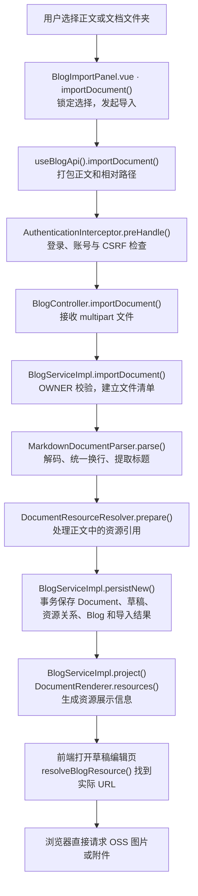
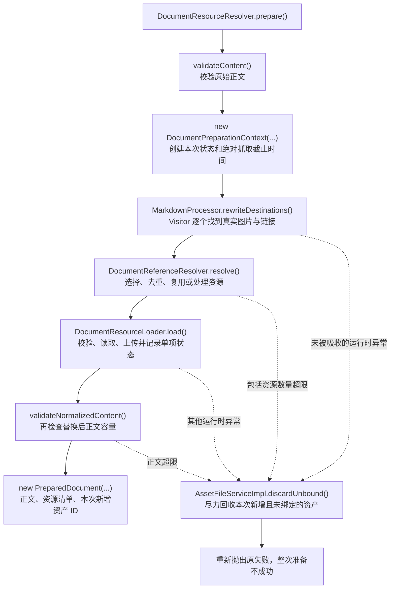
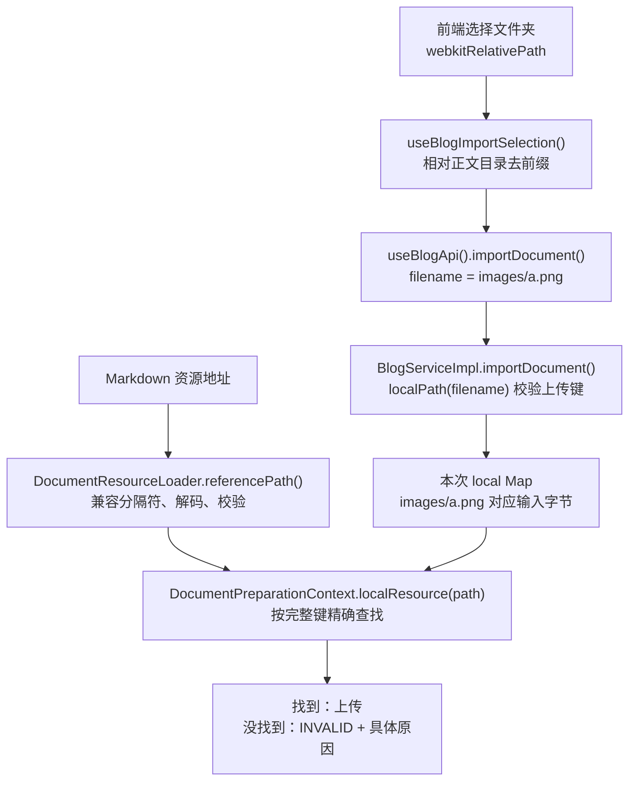
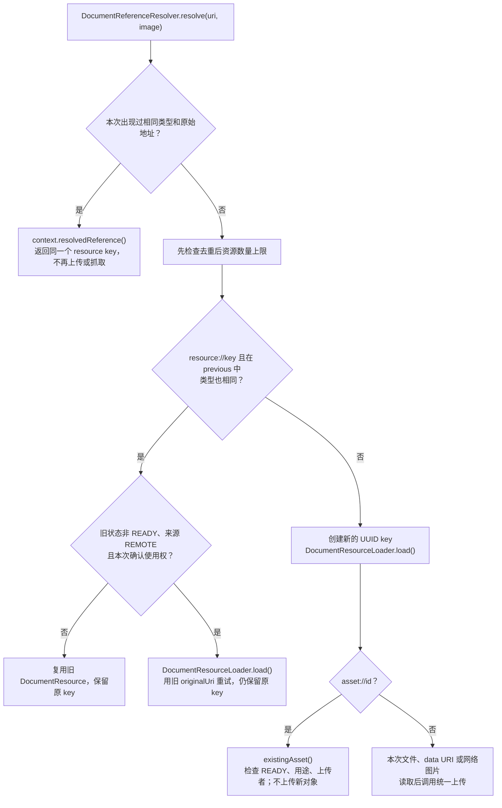
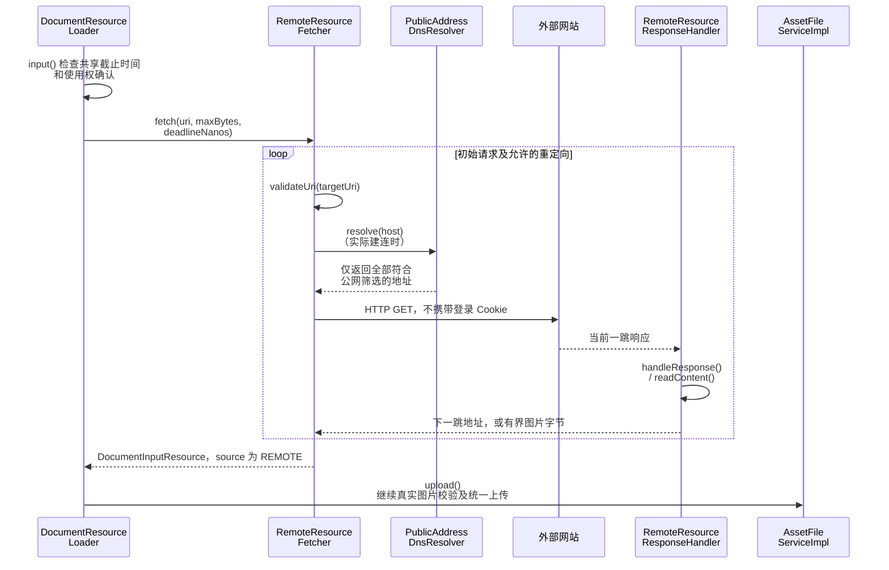
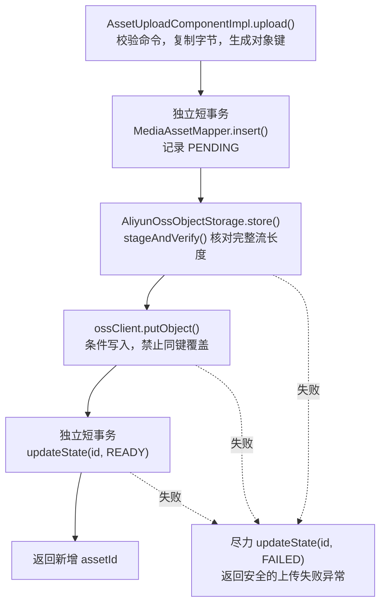
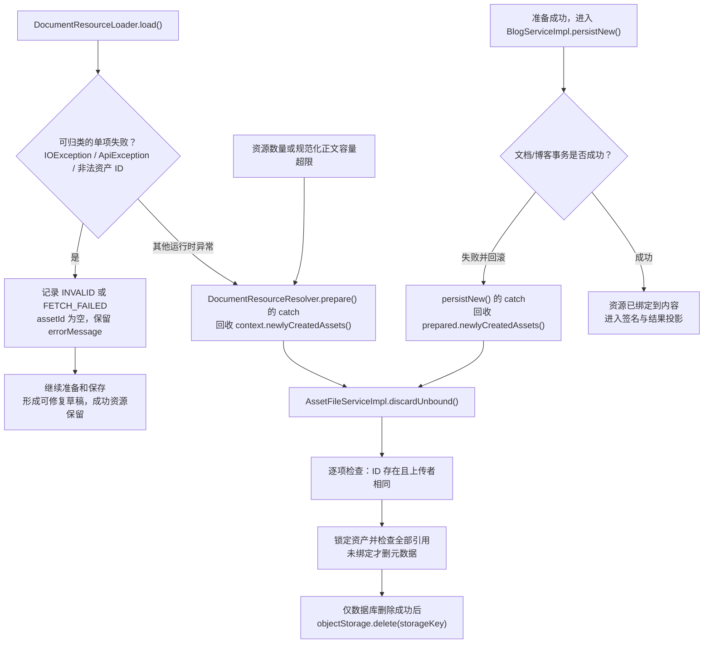
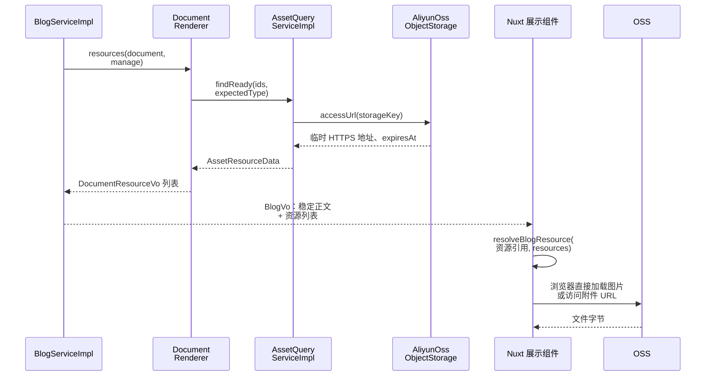

# 文档导入全链路：从电脑里的 Markdown 到可展示的博客草稿

想先快速了解核心业务链路，请读[精简版](document-import-quick-guide.md)。本文保留实现细节，供按需查阅。

这份文档用一个具体问题串起实现：**你选了一篇 Markdown，里面有本地图片、内嵌图片和附件；系统怎样把它变成博客，图片又为什么能显示？**

先看每节的“大白话”，再看图中的类和方法。代码节选用于解释关键判断，不要求你先懂 Java 或 Vue。

本文持久化模型已更新为 V8。新请求字段与动作以[博客 API 契约](../api/blog-document.md)为准；前端代码章节说明文件选择和相对路径原则，Nuxt 页面需同步适配。

## 1. 阅读范围

- 本文以仓库当前源码为准，覆盖 Markdown 导入、资源归档、博客保存和展示。
- 导出保留正文与携带资源两种选择；文章标题命名、平铺资源目录及其边界见第 20 节。
- 当前实际启用的是 **UTF-8 Markdown `.md` 导入**。DOCX、PDF Parser 尚未启用，不在本文中画成已经存在的能力。
- 这是现有功能的学习说明，不是新方案、验收报告或未来 RAG 设计。

正文中的调用、限制和失败行为均按上述代码说明；“为什么这样做”是帮助理解的解释，不能替代实现本身。配置表写的是源码默认值，实际部署可以通过配置改变。

## 2. 先用大白话看一遍

你交给系统的是“一份正文 + 一袋可能用到的图片和附件”。系统先核对身份和文件，再沿正文找到真正用到的资源，把需要新保存的文件交给统一上传能力。正文里的地址改为稳定编号，正文、资源关系和博客草稿一起存入数据库。展示时再用这些编号换取临时访问链接，浏览器直接到 OSS 取图片。

**数据库记“文章是什么、用了哪些文件”，OSS 存“文件的实际内容”。**



图里省略了统一认证请求包装、MapStruct 字段映射等细枝末节；后面会把资源处理和失败分支单独展开。

看图提示：方框是处理步骤，菱形是判断；沿箭头读。时序图从上往下看，实线箭头表示发起调用，虚线返回表示交回结果。方法名后的括号表示“执行这个动作”，不是需要手工输入的命令。

## 3. 先认清五样东西，别把它们都叫“文件”

| 名称 | 大白话 | 主要承载位置 |
| --- | --- | --- |
| 原始 `.md` | 你导入时交来的原稿 | 本次请求的 `MultipartFile`，不作为长期正文依据 |
| `ParsedDocument` | 刚读懂的原稿：标题、正文、待查找的输入文件清单 | 内存对象，Parser 输出 |
| `PreparedDocument` | 资源已处理、正文已换成稳定引用，但还没保存的结果 | 内存对象，含本次新增资产 ID |
| `Document` | 数据库文档身份与当前草稿或正式正文的组合 | `document`、`document_content`、`document_resource` |
| `Asset` | 一个已经登记的实际文件，知道它放在 OSS 哪里、谁上传、是否就绪 | `media_asset`；文件内容在 OSS |

`Blog` 则是“这篇文档作为博客，文章标识是什么、是否公开、是否允许公开下载”的外层业务信息，保存在 `blog_post`。

还要分清四种地址或编号：

| 示例 | 表示什么 | 是否是浏览器最终请求地址 |
| --- | --- | --- |
| `images/a.png` | 原稿中相对正文位置的本地文件名 | 否；导入时用来查上传清单 |
| `asset://48` | 编辑器已上传成功的资产 ID，尚待保存到文档内容 | 否 |
| `resource://某个key` | 文档资源的稳定引用编号 | 否 |
| HTTPS 签名 URL | 有到期时间的 OSS 访问凭证 | 是 |

**`resource_key` 不是 OSS 文件路径；`originalUri` 是溯源信息；`resourceUrl` 是临时展示结果。三者不能互换。**

### 3.1 遇到缩写，只要先记住这些意思

| 词 | 不写代码也能理解的含义 |
| --- | --- |
| Parser / 解析器 | 读懂原稿格式的人；把文件字节变成可处理的正文 |
| AST / 语法树 | 已分清标题、图片、链接、代码块的正文结构图 |
| Visitor / 遍历器 | 顺着结构图逐个检查图片、链接的工作人员 |
| Map / 映射 | 按完整名字查东西的字典，例如“路径 → 文件内容” |
| MIME | 上传者声明的内容类型，例如 `image/png`；还需要核验真实内容 |
| 元数据 | 文件的名字、大小、类型、位置等描述，不是图片字节本身 |
| 数据库事务 | 一组数据库修改一起确认；失败时撤回这一组未提交修改 |
| 补偿 | 对已发生的外部操作做后续回收，例如回滚文档后清理新增文件 |
| Bean / 单例 | 多次请求会共同使用的服务对象，所以不能把一次导入的临时状态随便塞进去 |
| VO / DTO | 给页面或模块传递结果的数据包，不是又一份正文或又一个文件 |

## 4. 第一步：前端到底选了哪些文件

入口是 `BlogImportPanel.vue`，选中内容由 `useBlogImportSelection()` 管理。

### 4.1 两种选择方式的实际区别

| 方式 | 正文怎么确定 | 资源上传时带什么路径 | 适合什么情况 |
| --- | --- | --- | --- |
| Markdown 文件 | 用户单独选择一个 `.md` | 附件只带 `file.name`，例如 `a.png` | 图片、附件都用叶子名称引用 |
| 文档文件夹 | `selectFolder(files)` 收集文件；只有一篇 `.md` 时自动选定，多篇时用户指定 | 用 `webkitRelativePath` 去掉正文所在目录前缀，例如 `images/a.png` | 原稿里有子目录、同名文件或较复杂资源结构 |

例如电脑里是：

```text
notes/
├── article.md
├── images/
│   └── a.png
└── files/
    └── guide.pdf
```

正文为：

```markdown

[附件](files/guide.pdf)
```

选整个 `notes` 文件夹后，前端应交给后端：

```text
正文：article.md
资源：images/a.png → 对应图片字节
资源：files/guide.pdf → 对应附件字节
```

如果只单独选图片和附件，前端通常只能拿到 `a.png`、`guide.pdf`。**后端不会猜它们原来属于哪个子目录，也不会按最后一段文件名随便匹配。** 此时正文仍写 `images/a.png` 就会找不到，应该改用文件夹模式或调整原稿路径。

### 核心代码 ①：相对谁计算路径

`useBlogImportSelection()` 中的 `importResources` 计算属性节选：

```ts
const directory = markdownPath.value.slice(0, markdownPath.value.lastIndexOf('/') + 1)
return folderFiles.value
  .filter((file) => file !== sourceFile.value && file.webkitRelativePath.startsWith(directory))
  .map((file) => ({ file, path: file.webkitRelativePath.slice(directory.length) }))
```

逐句翻译：

1. 找出**所选正文所在目录**，不是固定使用你点击的最外层文件夹。
2. 排除正文自己，只保留正文目录及其子目录里的候选文件。
3. 去掉正文目录前缀，让资源路径和 Markdown 里的相对写法处在同一个坐标系。

例如选择的是 `notes/posts/article.md`，图片是 `notes/posts/images/a.png`，最终资源路径是 `images/a.png`。`notes/images/a.png` 在正文目录之外，不会因为同名就被收进来。

### 4.2 此时哪些操作没有发生

选择文件不会立刻上传 OSS。`selectionIssue` 只检查有没有 `.md`、正文是否为空、是否有重复资源路径等。`canImport` 还会检查当前是否正在导入。

导入期间 `isImporting` 锁住切换与清空，避免请求用的是 A 文件，界面却变成 B 文件。`importRevision` 用于忽略离开页面后的迟到响应；**忽略响应不等于撤销后端已经创建的草稿**。

## 5. 第二步：把“一袋文件”发给后端

`BlogImportPanel.vue.importDocument()` 调用 `useBlogApi().importDocument(file, resources, rights)`。

### 核心代码 ②：资源路径不是额外说明，而是上传协议的一部分

```ts
const body = new FormData()
body.append('file', file)
body.append('remoteRightsConfirmed', String(rights))
body.append('requestId', requestId) // 同一次重试保持此 UUID
tagIds.forEach(id => body.append('tagIds', String(id)))
resources.forEach(({ file, path }) => body.append('resources', file, path))
return request<Blog>(BLOG_PATH + '/imports', { method: 'POST', body })
```

这里第三个参数 `path` 很关键：它成为每个资源分片的 `filename`。后端通过 `MultipartFile.getOriginalFilename()` 取到它，才能建立 `images/a.png → 文件内容` 的清单。

实际接口是：

```text
POST /api/v1/blogs/imports
Content-Type: multipart/form-data（由浏览器生成 boundary）

file：正文文件
resources：零个或多个图片/附件，filename 为相对正文的路径
remoteRightsConfirmed：是否确认允许抓取网络图片
```

普通的远程图片确认框不会替你上传本地缺失文件，也不会影响内嵌 Base64 图片。

### 5.1 谁能发起导入

- 前端 `useBlogApi().request()` 走 `createAuthInterceptor().request()`、`execute()`，按 OWNER 访问策略发请求，写请求带当前 CSRF，携带同源登录凭据。
- 后端 `AuthenticationInterceptor.preHandle()` 核对传输策略、真实登录态、账号有效性和 CSRF。前端缓存显示“已登录”不能代替这些检查。
- `BlogController.importDocument()` 带 OWNER 角色注解；`BlogServiceImpl.importDocument()` 又通过 `OwnerAuthorizationServiceImpl.requireOwner()` 守住业务调用边界。

登录或权限失败时，文件不会进入后面的文档归档流程。前端会话包装会处理 401/403 并刷新必要状态，**不会自动重放这次创建请求**，以免创建重复草稿。

## 6. 第三步：先点清资源，再读懂正文

`BlogController.importDocument()` 只接收参数，把可选资源列表规范为空列表，然后交给 `BlogServiceImpl.importDocument()`。

服务先做三件事：

1. 确认操作者，取得当前账号 ID。
2. 对每个上传资源用 `DocumentResourceResolver.localPath()` 校验上传键，拒绝重复路径，累计上传资源的声明大小。
3. 用 `BlogServiceImpl.read()` 有界读取文件；最多多读一个字节，防止客户端把大小报小后塞入更多内容。

结果是一个内存清单：`Map<String, DocumentInputResource>`。它保留相对路径、声明 MIME、字节和来源，**此时尚未上传 OSS**。

文件夹里没有被正文引用的候选文件，也会先计入本次输入数量/容量并读取；但后续只有正文实际需要归档的资源才会调用 Asset 上传。不是“整个目录全部原样上传到 OSS”。

接着调用 `MarkdownDocumentParser.parse(filename, input, resources)`。它保留导入格式、容量与异常提示等业务校验；通用文本处理委托 framework 的 `MarkdownProcessor.normalizeUtf8()` 和 `firstHeading()`：

| 处理 | 大白话 | 失败结果 |
| --- | --- | --- |
| `.md` 与容量检查 | 先确认原稿类型和大小 | 整次导入拒绝 |
| 严格 UTF-8 解码 | 不把乱码字节默默替换后存进去 | 整次导入拒绝 |
| 去 UTF-8 BOM | 去掉某些编辑器加在文件头的不可见标记 | 正常继续 |
| CRLF/CR 转 LF | Windows、其他平台的换行统一 | 正常继续 |
| 拒绝 NUL 字符 | 拒绝正文中的非法空字符 | 整次导入拒绝 |
| 提取首个顶层 H1 | 例如 `# 我的文章` 作为标题；没有则用去掉 `.md` 的文件名 | 正常继续 |

`MarkdownProcessor.firstHeading()` 内部只收集标题节点里的普通 `Text`，不把行内代码或 HTML 的字面内容作为标题拼进去。

Parser 返回 `ParsedDocument`。它只负责“读懂原稿”，不上传文件、不写数据库。这里拒绝的是空输入等非法情况；全空白正文未在这个阶段一律拒绝，发布时另有正文非空白检查。

## 7. 第四步：准备文档，不把所有逻辑挤在一个方法里

`DocumentResourceResolver.prepare()` 是资源准备的总入口。可以把它理解成工序调度员：



正文第一次校验失败时还没有产生资产，因此不需要走准备阶段的回收。单张资源的已知失败会被 `load()` 转成资源状态，和图中“整次准备抛异常”是两种结果。

### 7.1 本次状态到底存什么

`DocumentPreparationContext` 每次调用都新建，不放进 Spring 单例跨请求复用：

| 状态 | 用途 |
| --- | --- |
| `previous` | 当前文档草稿与正式正文的资源，给后续编辑保存复用；首次导入是空 Map |
| `local` | 本次上传的相对路径到输入文件的清单 |
| `remoteRightsConfirmed`、`uploader` | 本次网络图片授权选择与真实操作者 |
| `fetchDeadlineNanos` | 本次准备从开始计算的共享远程抓取截止时间 |
| `resolvedReferences` | 已处理的“资源类型 + 原始地址”，避免本次重复处理，保留首次出现顺序 |
| `newlyCreatedAssets` | 本次上传成功并返回的新增资产 ID，用于失败补偿 |

`PreparedDocument` 对集合做防御性复制，供后续保存使用；这些集合不是资源数据库，也不是跨请求缓存。

## 8. 哪些引用会进入资源归档

入口是 `DocumentReferenceResolver.shouldArchive()`，随后由 `resolve(uri, image)` 处理。

| 原稿写法 | 当前行为 |
| --- | --- |
| `` | 图片，进入资源处理 |
| `[附件](files/a.pdf)` | 没有协议的本地链接，作为附件处理 |
| `` | 内嵌图片，解码后走统一 Asset |
| `` | 网络图片；明确确认使用权后尝试抓取 |
| `[网站](https://example.test/a.pdf)` | 普通网络超链接，保留原样，**不会下载成附件** |
| `[邮箱](mailto:someone@example.test)`、`[章节](#intro)` | 普通链接/锚点，保留原样 |
| ``、`[附件](asset://49)` | 引用已上传资产，核对用途和上传者 |
| `` | 只从当前文档旧资源清单中尝试复用 |
| 代码块或行内代码中的图片示例 | 不当作真实图片处理 |

这里说的是 CommonMark 识别的图片/链接节点。`` 这样的原始 HTML 不等同于 Markdown 图片节点，当前 Visitor 不负责从任意 HTML 中提取并归档资源。也不能把网络确认框理解成“下载文章里所有网络链接”。

## 9. 最重要的细节：本地路径到底怎么对上

**匹配依据是安全处理后的完整相对路径，不是图片名字、电脑上的绝对地址，也不是 OSS 目录。**



### 9.1 上传路径与引用路径是两个入口

- `localPath()` 处理前端上传键，要求它已经是安全的相对路径；不会读取服务器磁盘。
- `referencePath()` 处理正文里的地址，先做允许的兼容处理，再交给 `localPath()` 守住同一安全边界。

### 核心代码 ③：兼容 Windows 写法，不放开目录越界

`DocumentResourceLoader.referencePath()` 节选：

```java
uri = uri.replace('\\', '/');
if (uri.matches("(?i).*%(2f|5c).*")) {
    throw invalid("资源地址不能编码路径分隔符");
}
try {
    return localPath(URLDecoder.decode(uri.replace("+", "%2B"), StandardCharsets.UTF_8));
} catch (IllegalArgumentException failure) {
    throw invalid("资源地址编码无效");
}
```

翻译成使用规则：

| 正文地址 | 处理结果 |
| --- | --- |
| `images\a.png` | 兼容成 `images/a.png`，再查上传清单 |
| `images/图%20a.png` | 解码成 `images/图 a.png`，支持中文与空格 |
| `images/a+b.png` | 加号保持加号，不错误地变成空格 |
| `images/%E5%9B%BE.png` | UTF-8 百分号解码后匹配中文文件名 |
| `images/../a.png` | `Path.normalize()` 规整为 `a.png`，仍需在清单中存在 |
| `../a.png`、`..\a.png` | 越出正文根目录，拒绝 |
| `/a.png`、`C:\a.png`、`\\server\a.png` | 绝对路径、盘符或网络共享路径，拒绝 |
| `images%2Fa.png`、`images%5Ca.png` | 把目录分隔符藏进编码，拒绝 |
| 非法 `%` 编码、控制字符、`< > : " | ? *` 等危险字符 | 拒绝 |

本地地址也不会套用网站 URL 的“去掉查询和锚点”规则：`images/a.png?ver=1` 会因危险字符被拒绝；`images/a.png#part` 中的 `#part` 会按文件名文字参与查找，通常匹配不到 `a.png`。要引用本地文件，请直接写它在输入清单中的相对路径。

文件名本身真的叫 `literal%20.png` 时，上传清单保留字面 `%20`；正文若要引用这个字面名称，应写 `literal%2520.png`。因为正文地址有一层 URL 解码，上传文件名没有这层解码。

### 9.2 为什么不会自动去电脑或服务器找缺失文件

`input()` 最终只调用 `context.localResource(referencePath(uri))`。后端拿不到你的浏览器未选择的文件，也不会因为正文写了一个盘符就读取服务器上的对应路径。

找不到时留下：

```text
status = INVALID
assetId = null
errorMessage = 未找到对应的本地文件，请检查相对路径并选择包含资源的文档文件夹
```

所以“文件在你电脑上存在”不等于“这次请求已经按正确路径提交了它”。两个目录中同名文件不会按名称互相冒充；大小写也没有额外的不区分处理。

## 10. “已有复用”有三种情况，不能混为一谈



### 核心代码 ④：一次正文中的去重规则

```java
ResourceType type = image ? ResourceType.IMAGE : ResourceType.ATTACHMENT;
String token = type + ":" + uri;
DocumentResource resource = context.resolvedReference(token);
if (resource != null) {
    return resource.reference();
}
```

同一个 `a.png` 作为图片出现两次，本次只处理一次；同一地址既当图片又当附件，属于两种不同用途，分别处理。去重使用的是**原始地址文本**，并非内容哈希：`a.png` 和 `./a.png` 不保证合成一次上传，即使最后能找到同一个本地输入。

### 10.1 复用旧文档资源：`resource://key`

后续 `BlogServiceImpl.saveContent()` 会先读取当前文档旧资源，按 key 建立 `previous`，再调用同一个 `prepare()`。

- 找到旧 key 且类型一致，默认直接沿用，避免保存一次就重新上传全部图片。
- 只有旧资源非 READY、来源为 REMOTE、这次明确确认网络使用权，才通过 `previousResource()` 发起重试。
- 重试成功或失败都沿用旧 key，避免正文引用编号跟着变化。
- 失败本地资源不会凭空补到文件；需要上传缺失文件后替换引用，或重新导入完整原目录。
- 失败内嵌资源的来源只保留 MIME 描述，不能靠它还原已经丢弃的 Base64；应修正原稿重新导入。

**首次导入传的是 `Map.of()`，没有已有内容资源可复用。** 从另一篇文章复制一个 `resource://key` 不代表获得那篇文章的资源；系统不会按 key 做全站搜索来帮你绑定。

### 10.2 复用已经上传的资产：`asset://id`

编辑页 `BlogEditor.vue.uploadResource()` 先调用 `useAssetApi().upload()` 上传文件，暂时向正文插入 `asset://id`。保存时 `existingAsset()` 检查资产就绪、用途匹配、上传者是当前账号，随后建立文档关系。

它不会重新上传，也不会把这个既有 ID 加进 `newlyCreatedAssets`。OWNER 身份不意味着这里可以跳过上传者归属检查。

### 10.3 再导入同一文件夹：通常是新建，不是自动复用

同名文件、相同内容甚至记录中有 SHA-256，都不表示系统实现了“按哈希查重并复用”。当前上传组件会生成新的 OSS 对象键。

导入接口也没有按文件生成的幂等键。**再点一次导入可能再建一篇草稿和一批资产。** 网络超时后应先查看管理列表，别假定“没收到成功响应就一定没保存”。

## 11. 内嵌 data URI：图片原来就藏在正文里

这种写法把图片字节变成文字，直接放在 Markdown 地址中：

```markdown

```

处理调用是：

```text
DocumentResourceLoader.load()
  → DocumentResourceLoader.input()
  → DocumentDataUri.decode(uri, AssetUsage.IMAGE)
  → DocumentInputResource（source = EMBEDDED）
  → AssetFileServiceImpl.upload()
```

它不需要到你的磁盘找图片，也不需要上网抓取，因此不受“确认网络图片使用权”开关影响。仍然需要操作者有导入权限，也仍然接受真实图片校验。

`DocumentDataUri.decode()` 的实际检查顺序：

1. 必须用于正文图片，必须有正确的 `data:` 头与逗号，头部不能超过 128 个字符。
2. 必须是 `image/...;base64` 形式；支持解析 MIME 参数，提取实际 MIME。不是任意 `data:` 内容都能作为图片或附件通过。
3. 解码前按图片单文件上限计算可接受的 Base64 长度，避免先分配巨大字节数组再发现超限。
4. 用标准 Base64 解码；编码损坏、空内容、真实字节超限分别拒绝。
5. 把字节交给统一 Asset 图片校验器。PNG、JPEG、WebP 要与真实内容匹配；SVG 不在当前允许范围。

**Base64 不是“可信图片证明”。** 随便把脚本或损坏文件编码成 Base64，不能绕过后面的 MIME、解码、尺寸和输出容量校验。

来源字段只留 `data:image/webp;base64` 这样的短描述，不保存后面的编码；正文最终也会替换成 `resource://key`。普通 URL 的 2048 字符限制不套在内嵌图片整串编码上，但原始正文仍受 UTF-8 字节总量上限限制。

WebP 由 ImageIO 的运行时插件解码，随后转为 PNG。不会为了文档导入另建一套 OSS 上传服务，也不依赖浏览器偷偷转换后再上传。

## 12. 网络图片：后端临时抓一份，再按自己的资源管理

这里的“远程新建”是**把外站图片下载、校验、保存成自己的 Asset**。普通展示时就不再依赖外站图片地址，而是使用本项目 OSS 地址。



### 12.1 为什么要管它能访问哪里

如果允许后端按任意网址取文件，有人可能利用它访问服务器内网、回环地址或云环境的内部服务。`PublicAddressDnsResolver.resolve()` 在**实际建立连接时**检查解析结果，只要混入一个不符合现有公网筛选规则的地址，就拒绝这一轮解析。

`RemoteResourceFetcher.validateUri()` 还要求：HTTP/HTTPS、有主机名、不带 URL 用户名密码和 fragment，端口省略或为 80/443。不能把代码注释“默认端口”理解成严格校验了协议与端口必须一一对应；实际条件接受上述两个显式端口。

重定向由 `fetch()` 自己逐跳处理，每跳重新校验；HTTP 客户端禁用自动重定向、Cookie 管理和自动重试。普通账号登录信息不会顺带发给外站。

### 12.2 怎样防止无休止抓取

- 每篇正文准备时就创建一个共享截止时间，后面的网络请求共用它，不是每张图重新获得完整预算。
- 建连、获取连接、等待响应都设置超时；实际请求的剩余预算会进一步压缩超时。
- `RemoteResourceResponseHandler.readContent()` 检查声明大小、实际累计字节数和读取时间，关闭输入流。
- 重定向默认最多 3 次，即初始请求之后最多再跟随 3 跳。
- 这是网络抓取预算，不代表整个导入 HTTP 请求（含本地处理、OSS、数据库）会在 15 秒精确终止。

### 12.3 当前容易看错的两个限制

1. **远程响应入口仍只接受 PNG/JPEG MIME。** 当前 Asset 校验器支持 WebP，所以本地/内嵌 WebP 能通过；但远程 WebP 仍会先在响应处理器被拒绝。本文描述的是现状，没有把未接通的格式写成已经支持。
2. `sourceReference()` 会隐藏 URL 用户信息及常见鉴权查询参数后再存来源。旧失败网络资源重试使用的是已保存的 `originalUri`；如果它原本依赖临时签名或令牌，被脱敏或过期后不保证还能重试成功，需要用户提供有效原始地址。

当前 `IOException` 的管理提示仍归纳为网络图片读取失败，不能仅凭这个文案精确判定是 DNS、目标限制还是网络中断。不要把资源诊断理解成已经有了完整的网络错误分类系统。

## 13. 真正上传文件：只有一套 Asset 生命周期

无论来自本地、data URI 还是网络，最终都调用：

```text
AssetFileServiceImpl.upload(usage, uploader, filename, contentType, bytes)
  → 图片：ImageContentValidator.inspect()
  → 附件：安全文件名及通用下载类型处理
  → AssetUploadComponentImpl.upload(AssetUploadRequest)
  → AliyunOssObjectStorage.store(ObjectStorageWriteRequest)
```

### 13.1 图片和附件的差别在哪里

| 内容 | 当前实际处理 |
| --- | --- |
| 图片 | 校验字节上限、声明 MIME、真实格式；解码前读取宽高并检查；解码后重编码，去掉 EXIF 等附加内容；再次检查输出大小 |
| PNG/JPEG | 输出经过重编码的 PNG/JPEG |
| WebP | 解码后输出 PNG，保留透明度由解码及回归测试约束 |
| 附件 | 校验字节和安全叶子文件名，用 `application/octet-stream` 作为下载类型；不会按扩展名把任意附件当图片解码 |

上传时按 **Markdown 节点用途** 决定 `IMAGE` 或 `ATTACHMENT`，不是只看文件后缀。把 `.png` 作为普通链接附件使用，走的也是附件规则。

图片保留安全原文件名主体，转码后扩展名与实际 PNG/JPEG 一致；附件保留安全叶子名。旧记录已丢失的原名不能靠 UUID 恢复。原稿路径仍由文档资源的 `originalUri` 溯源，不要求 OSS 复制你的目录结构。

### 13.2 OSS 对象键和原稿路径各管各的

`AssetUploadComponentImpl.upload()` 生成新对象键：

```java
String key = request.usage().objectPrefix() + "/" + UUID.randomUUID() + extension;
```

例如输入清单是 `images/a.png`，OSS 对象键可能是 `assets/images/某个UUID.png`。图片保存在自己的随机位置，正文靠资源关系找它，不能把二者相等当成匹配条件。

上传组件还会复制输入字节，计算 SHA-256、记录大小及类型。**计算哈希用来记录内容身份，不等于已经实现按哈希复用。**

### 13.3 文件本身先经历 PENDING → READY



Asset 的短事务用 `REQUIRES_NEW`；外层事务通过 `NOT_SUPPORTED` 在上传期间暂停。不会一边等待 OSS，一边把整篇文档事务和数据库连接一直占着。

OSS 适配器先暂存输入流并核对长度，再上传；`finally` 清理这次本地暂存文件。**这只是本地暂存文件清理，不等于上传失败时一定删除 OSS 对象。**

## 14. 图片地址怎样被换掉，又不破坏代码块

`MarkdownProcessor.rewriteDestinations()` 使用 CommonMark 解析得到语法树（AST）。你可以把 AST 理解成“编辑器已经区分好的正文结构”：这里是图片、那里是链接、那段是代码。

- `MarkdownDestinationVisitor.visit(Image)` 把 `image=true` 交给 `DocumentReferenceResolver.resolve()`。
- `visit(Link)` 把 `image=false` 交给同一个方法。
- `changed()` 记录**地址真的变化的节点**以及它在原文中的 `SourceSpan` 位置。
- 代码中的 `` 属于代码节点，没有被当作图片节点访问，所以不会误上传。
- 公式中的示例引用也由 starter 当作公式原文保留，不触发资源上传；是否复用、抓取或上传真实资源，仍由博客的 `DocumentReferenceResolver` 决定。

返回的正文形如：

```markdown

[附件](resource://稳定keyB)
```

### 14.1 为什么不能简单正则替换整篇正文

例如：

```markdown
[](files/guide.pdf)
```

外层链接里还有图片。Visitor 先修改外层节点，再访问子图片；记录的是节点引用，所以最后渲染外层时，已经包含了里面改过的图片。

`rewrite()` 将候选修改按起点从前往后、同起点终点从后往前排序，只选择最外层不重叠区间。这样同一小块原文不会既替换外层又替换内部一次。

### 核心代码 ⑤：为什么从末尾往前改

```java
for (var edit : outerEdits.reversed()) {
    rewrittenMarkdown.replace(edit.start(), edit.end(), markdownRenderer.render(edit.node()));
}
```

假设第 20 个字和第 100 个字各有一张图。先改前面的地址会改变后面地址的字符位置；先改第 100 个字所在区间，就不会干扰前面的原始位置。

这里仅重渲染被修改的图片/链接子树，**不是把整篇 Markdown 转成 HTML 再转回来**。未修改部分尽量原样保留；但被替换节点内部的转义、标题格式可能由 CommonMark 重新表达，不能承诺整篇逐字节完全不变。导入边界本身也已经统一了 BOM 和换行。

此阶段针对后端 CommonMark 的处理，不等于前端编辑器完全没有自己的 Markdown 转换规则。

## 15. 第五步：共同保存草稿、资源、标签和博客

`BlogServiceImpl.persistNew()` 使用短事务。它仅负责新建/导入：调用 `DocumentService.create()` 插入文档身份，草稿、关系、博客及导入记录共同提交。后续正文和属性由 `saveContent()/saveProperties()` 分别保存，共用 `beginWrite()` 的文档锁及 revision；只更新所属字段，正式正文保持不变。

| 表 | 保存什么 |
| --- | --- |
| document | 身份、revision、创建与最近写请求的重试摘要 |
| document_content | DRAFT/PUBLISHED 各最多一条，保存标题、摘要、Markdown |
| document_resource | 内容的稳定 key、Asset、来源、状态和具体错误 |
| document_content_tag | 当前内容的标签选择与名称、slug、类别快照 |
| blog_post | slug、公开状态、下载许可，不保存版本指针 |
| document_import_task | 来源、SHA-256、结果与问题 |

保存只更新工作草稿，公开正文不变；管理详情无草稿时以正式正文作为编辑初值。标签随草稿发布，下载许可保存后立即生效。

`BlogServiceImpl.transition()` 区分四种动作：publish 校验已保存的 slug/标题/正文/资源，在同一事务删除旧正式关系并提升草稿；unpublish 只隐藏；restore 只重新开放正式正文；DISCARD_DRAFT 在已有正式正文时只删除草稿。整篇删除必须下架，有正式正文时还必须先处理草稿；从未发布的纯草稿文章可直接整篇删除。

`revision` 是统一写修订，不是历史版本。乱序请求和发布后迟到的旧保存返回 409；同一请求 ID/输入可识别近期已提交重试。删除内容或关系不删除共享 Asset。

## 16. 最需要理解的地方：失败后到底删什么、不删什么

先分清两句话：

> “这一张图处理失败”不一定导致“整篇草稿创建失败”。
>
> “数据库回滚了”不等于“已经上传的 OSS 文件也自动回滚了”。

### 16.1 三层失败处理图



### 核心代码 ⑥：只记“本次上传成功的新增资产”

`DocumentResourceLoader.load()` 中，上传成功返回后才登记：

```java
assetId = assetFileService.upload(
        usage, context.uploader(), input.path(), input.contentType(), input.content());
context.recordCreatedAsset(assetId);
```

因此回收集合不包含：

- `previous` 里沿用的历史资源；
- `asset://id` 指向的既有资产，包括编辑器在这次保存之前上传的文件；
- 别人的资产；
- 某次上传尚未成功返回给准备层的资产 ID。

### 16.2 为什么先删数据库，再删 OSS

`AssetFileServiceImpl.discardUnbound()` 在独立事务中锁定 Asset，核对上传者并检查 Document、项目、账号头像和站点资料的全部引用，确认未绑定后删除元数据。绑定方通过 `AssetQueryService.lockReady()` 使用同一行锁，补偿等待绑定提交后会看到新引用。数据库提交后才删除 OSS，不依赖外键报错保护共享文件。

只有数据库删除确实成功，才调用 `objectStorage.delete()`。这样不会先把已被其他业务使用的文件删掉，最后才发现数据库不准删。

回收是逐个尽力处理：一个失败只记安全日志，继续处理其他 ID，不扩大成整批清理异常。

### 16.3 必须诚实理解的可靠性边界

| 情况 | 当前结果 |
| --- | --- |
| 一张本地图片缺失，其他图片成功 | 缺失图片留下 INVALID；草稿可保存，成功资源继续绑定，不整批删除 |
| 第一张上传成功，第二张触发未处理异常 | 准备阶段回收已登记的第一张；整次准备失败 |
| 全部上传成功，但文档/博客事务失败 | 数据库事务回滚；保存层回收本次新增未绑定资产 |
| `AssetUploadComponentImpl.upload()` 中 OSS 写入/READY 更新失败 | 尽力标 FAILED 并抛上传失败；**该组件不自动删除 OSS 对象**，该 ID 也未成功返回准备层 |
| 回收时数据库删除成功，OSS 删除失败 | 可能留下没有数据库记录的孤儿对象；记日志，不恢复资产记录 |
| 回收时资产被绑定、上传者不符或记录不存在 | 跳过/删除失败，不删除 OSS |
| 进程突然退出、网络状态不确定 | 当前同步 catch 无法保证执行或准确获知远端结果 |

**现有补偿不是跨数据库与 OSS 的“全有或全无”事务，也不是可靠的后台清理队列。** `prepare()` 中仍有异步补偿 TODO，当前没有因为这个 TODO 就启用 MQ、后台重试或定时清理。不能承诺所有孤儿文件都会自动消失。

Asset 层的 PENDING/FAILED 记录和文档层的 INVALID/FETCH_FAILED 是两套不同的状态：前者说“文件上传是否完成”，后者说“这篇文档中的这个引用是否可用”。

## 17. 保存完之后，图片怎样真正显示

`BlogServiceImpl.project()` 调用 `DocumentRenderer.resources(document, manage)`：

1. 按 IMAGE/FILE 汇总资源中的 Asset ID，调用 `AssetQueryServiceImpl.findReady(Set, type)` 批量查询，而不是每个正文节点各查一次。
2. 只为匹配类型、元数据完整且 READY 的资产生成地址。
3. `AliyunOssObjectStorage.accessUrl()` 调用 `ossClient.generatePresignedUrl()`，返回 HTTPS URL 与 `expiresAt`；这里不下载图片，也不验证实际对象字节是否仍存在。
4. `DocumentConvert.to(...)` 组成资源 VO。管理投影额外给出 `originalUri` 和 `errorMessage`；公开投影隐藏这两项。



普通 Markdown 展示中，`BlogRenderer.vue` 注入内容资源列表；`BlogImage.vue`、`BlogLink.vue` 调用 `resolveBlogResource()`：先按 key 找当前内容资源，再检查 READY、图片类型及安全 URL，最后设置实际图片地址或附件链接。没有就绪资源则显示占位，不让浏览器把 `resource://` 当真实网络协议发出去。

管理编辑器也利用资源投影展示图片；其“待修复资源”面板在 `BlogEditor.vue` 中优先显示 `resource.errorMessage`。资源 URL 到期刷新由 `useAssetUrlRefresh()` 根据到期时间调度，不是每刷新一次就重新上传。

私有 Bucket 地址有有效期，默认由 `MediaStorageProperties.signedUrlTtl` 决定（源码默认 1 小时）。签名过期只需要获取新投影，不改变正文 key，也不重传文件。

### 17.1 预览失败，不要误判成草稿没保存

`BlogServiceImpl.persistNew()` 先提交数据库，再调用 `project()`。若管理投影的资源签名发生已知 5xx，`project()` 返回 `previewIssue`，说明正文已保存、预览暂不可用。

若资产元数据当前已找不到，投影会把原来 READY 的资源展示为不可用，并给出“已绑定的资源不存在或尚未就绪，请重新上传”；它不会回写已保存内容的资源状态。

签名生成也不意味着真的请求过 OSS 确认图片存在；例如元数据还在但对象已被外部删除，最终浏览器仍可能加载失败。网络超时或未知错误发生在提交之后时，也不能据响应失败断言数据库完全没有写入。

## 18. 怎么看错误，才知道该改哪里

整次请求被拒绝时，`BlogImportPanel.vue.importDocument()` 的 catch 交给 `useFeedback().error()` 提示。请求成功但有坏资源时，面板提示“草稿已导入，若干资源待修复”，进入编辑页逐项处理。

| 具体提示/现象 | 失败位置 | 用户可以怎么处理 |
| --- | --- | --- |
| `.md`/UTF-8/正文超限 | `MarkdownDocumentParser.parse()`、`read()` | 改成 UTF-8 Markdown，检查文件与正文容量 |
| 上传资源路径重复、资源总量超限 | `BlogServiceImpl.importDocument()` | 移除重复项，选择正确目录，减少本次资源 |
| 找不到对应本地文件 | `DocumentResourceLoader.input()` | 看完整相对路径，选正文所在文档文件夹，不只选几个叶子文件 |
| 本地路径无效、越界、编码分隔符 | `referencePath()` / `localPath()` | 用正文目录内安全相对路径，不用盘符、`../` 或藏起来的分隔符 |
| Base64 损坏/内嵌 MIME 无效 | `DocumentDataUri.decode()` | 从原编辑器重新导出正确 data URI，或把图片存文件后引用 |
| 格式不支持、MIME 不一致、图片无法解码 | `ImageContentValidator.inspect()` | 使用真实 PNG/JPEG/WebP；不要只改扩展名或声明类型 |
| 图片过大、宽高超限 | `inspect()` | 缩小图片；压缩后的输入和重编码输出都需满足限制 |
| 未确认网络图片使用权 | `DocumentResourceLoader.input()` | 确认确有使用权后勾选，再重新处理；不要对无权资源盲目勾选 |
| 网络图片读取失败 | `RemoteResourceFetcher.fetch()` 等 | 检查地址、网络、访问限制和远程 MIME；此文案未细分全部网络根因 |
| 无权引用其他账号资产、用途不匹配 | `existingAsset()` | 使用本人上传且用途正确的资产，不手填别人的 ID |
| 文件上传失败 | `AssetUploadComponentImpl.upload()` | 检查存储服务和服务端安全日志，再按实际情况重试 |
| 遗留资源未记录具体原因 | 旧资源没有 `error_message` | 原因不能事后猜回去，重新导入原文件获得新诊断 |

新的错误原因由 `DocumentResourceLoader.load()` 形成安全摘要，随资源关系保存。数据库一行失败资源还能读回相同原因，页面刷新不会只剩下一个笼统 INVALID。异常的原始 SDK 文本、签名 URL、Base64 内容不作为错误提示直接回传。

这里的 512 字符是诊断摘要容量，不是把任意详细日志都塞进数据库。READY 资源的诊断为空；迁移遗留资源也可能为空。

## 19. 用一篇原稿完整走一遍

目录：

```text
testmarkdown/
├── textmarkdown.md
├── images/
│   └── local.png
└── files/
    └── guide.pdf
```

原稿示意，编码部分省略：

```markdown
# 我的文章


[说明附件](files/guide.pdf)
[项目官网](https://example.test/)
```

顺序发生的事情：

1. 文件夹模式确定 `textmarkdown.md` 为正文；资源列表里是 `images/local.png`、`files/guide.pdf`。
2. `.md` 作为正文发送，两个文件以各自相对路径作为 multipart filename 发送。
3. 后端严格读正文，得到标题“我的文章”。
4. 第一个图片节点：解析 WebP data URI → 校验真实图片 → 转 PNG → 上传 OSS → 得到 Asset A、资源 key A。
5. 第二个图片节点：`images\local.png` 规范为 `images/local.png` → 从输入清单拿到图片 → 校验上传 → 得到 Asset B、资源 key B。
6. 附件节点：按 `files/guide.pdf` 精确查找 → 统一附件上传 → 得到 Asset C、资源 key C。
7. 官网链接是普通 HTTP(S) 超链接，不下载、不建 Asset。
8. 正文中的三个资源地址分别换成 `resource://keyA`、`resource://keyB`、`resource://keyC`。这里的 A/B/C 仅示意，实际新 key 为 UUID。
9. 一次文档/博客事务保存唯一草稿、三个资源关系、标签和导入结果，再创建未公开博客。
10. 管理响应给出稳定正文及 A/B/C 的签名地址；浏览器向 OSS 请求图片/附件。
11. 后续保存继续沿用这些 key，不因重新显示或刷新签名而重复上传。

如果第 5 步缺少本地截图，但第 4、6 步成功：仍可保存草稿，B 是失败资源；A、C 正常绑定。发布前必须处理 B。若数据库提交失败，则回收本次成功返回的 A、C 等新增未绑定资产，历史资产不进入这批回收。

## 20. 导入后的导出为什么是另一条文件读取链路

虽然本文重点是导入，这个出口能帮助确认正文最终不依赖原始 `.md`：

```text
BlogController.export()
  → BlogServiceImpl.exportDocument(id, view)【先登录/授权、选择当前内容】
  → DocumentExportServiceImpl.prepare(document, includeResources)
  → DocumentRenderer.resources() 与 markdown()【准备输出地址】
  → StreamingResponseBody 调用 exportPlan.writer().write(output)
```

| 选择 | 实际输出 | 正文里的资源地址 |
| --- | --- | --- |
| 只导出正文 | `.md` | 临时 OSS 签名 URL，有效期过后不能当永久离线地址 |
| 包含资源且确有资源 | `.zip` | `resources/安全文件名`，包内真实带文件 |
| 正文没有资源，即使勾选包含资源 | `.md` | 无资源需要打包 |

当前 `prepare()` **无论输出 MD 还是 ZIP，都会先检查全部资源就绪**；有坏资源时不是简单忽略坏图然后继续导出。

ZIP writer 调用 `AssetFileServiceImpl.openReady()` → `AliyunOssObjectStorage.open()`，按缓冲区从 OSS 读流、写 ZIP，逐个关闭读取流并检查字节数。包内文件名会清理目录穿越、Windows 危险字符和保留名，图片和附件平铺在同一个目录；重名时添加序号，避免解压到 Windows 时互相覆盖。导出文件和 ZIP 根目录正文均使用文章标题。

完整写入才 `finish()`；中途失败不把缺资源 ZIP 包装成完整成功文件。流响应已经开始后，不能保证还能变回一个整齐的 JSON 错误响应。

**普通图片展示走浏览器直连；受保护导出为了打包读取字节。二者不是同一个“图片代理接口”。** 导出不会回写正文，不修改 Document 内容，也不要求重新解析原始导入文件。

## 21. 这些限制具体从哪里来

| 限制 | 源码默认值 | 事实来源/适用边界 |
| --- | --- | --- |
| 正文 UTF-8 字节数 | 2 MiB | `DocumentProperties.maxContentBytes`；导入前、准备前及替换后分别核对 |
| 本次输入资源数、去重后正文资源数 | 各按 50 上限检查 | `maxResources`；两次检查对象不同，候选但未引用文件也计入输入数量 |
| 本地上传候选资源合计 | 64 MiB | `maxImportBytes`；正文另算，内嵌编码已计入正文容量 |
| 普通正文图片 | 8 MiB、单边最大 4096 像素 | `AssetUsage.IMAGE`；不是把头像限制套过来 |
| 附件 | 64 MiB | `AssetUsage.ATTACHMENT`；也受本次导入资源总量限制 |
| 远程连接、读取、整篇共享抓取预算 | 3 秒、5 秒、15 秒 | `DocumentProperties`；不是整个导入事务的总超时 |
| 跟随重定向 | 3 次 | `maxRedirects` |
| 普通来源地址、资源 key、诊断摘要 | 2048、36、512 字符 | `DocumentPolicy` 与数据库对应列 |
| data URI 头部 | 128 字符 | `DocumentDataUri.MAX_HEADER_LENGTH`；编码主体另外按容量检查 |
| 签名 URL 默认有效期 | 1 小时 | `MediaStorageProperties.DEFAULT_SIGNED_URL_TTL`；可配置 |

导入不是全程流式的：当前正文、已选择本地资源、远程图片和 Base64 解码都存在有界的内存字节对象；OSS 适配器另有短期暂存。ZIP 导出才按文件流逐段复制。不能仅因为某处使用了 InputStream，就认定整条导入链路完全不占内存。

## 22. 建议按这个顺序读代码

不懂代码可以先重复看第 2、9、10、16、19 节；开始读实现时，依次定位下面这些入口。Mapper 的 SQL 包装和 Convert 字段映射只需先知道用途，把注意力留给路径、状态、事务和删除顺序。

| 文件 | 重点方法 | 先关注什么 |
| --- | --- | --- |
| [BlogImportPanel.vue](../../mai-portfolio-frontend/app/components/BlogImportPanel.vue) | `importDocument()、selectFolder()` | 导入按钮、请求锁定、成功/失败提示 |
| [useBlogImportSelection.ts](../../mai-portfolio-frontend/app/composables/useBlogImportSelection.ts) | `useBlogImportSelection() / importResources` | 选定正文，按正文目录计算资源路径 |
| [blogs.ts](../../mai-portfolio-frontend/app/api/blogs.ts) | `useBlogApi().importDocument()、save()` | FormData、导入与后续保存请求 |
| [authInterceptor.ts](../../mai-portfolio-frontend/app/api/authInterceptor.ts) | `createAuthInterceptor() 内 request()、execute()` | 会话、CSRF、401/403 与不自动重放 |
| [BlogController.java](../../mai-portfolio-backend/mai-portfolio-modules/mai-portfolio-module-blog/mai-portfolio-module-blog-service/src/main/java/dev/amai/portfolio/blog/controller/BlogController.java) | `importDocument()、export()` | HTTP 参数及导入/导出响应 |
| [BlogServiceImpl.java](../../mai-portfolio-backend/mai-portfolio-modules/mai-portfolio-module-blog/mai-portfolio-module-blog-service/src/main/java/dev/amai/portfolio/blog/service/impl/BlogServiceImpl.java) | `importDocument()、persistNew()、saveContent()、saveProperties()、project()` | 导入业务编排，文档/博客事务与结果投影 |
| [MarkdownDocumentParser.java](../../mai-portfolio-backend/mai-portfolio-modules/mai-portfolio-module-blog/mai-portfolio-module-blog-service/src/main/java/dev/amai/portfolio/blog/component/MarkdownDocumentParser.java) | `parse()` | 导入格式、容量、错误提示和 Document 输入；委托 framework 处理文本 |
| [DocumentResourceResolver.java](../../mai-portfolio-backend/mai-portfolio-modules/mai-portfolio-module-blog/mai-portfolio-module-blog-service/src/main/java/dev/amai/portfolio/blog/component/DocumentResourceResolver.java) | `prepare()` | 资源准备入口与整次准备失败回收 |
| [DocumentPreparationContext.java](../../mai-portfolio-backend/mai-portfolio-modules/mai-portfolio-module-blog/mai-portfolio-module-blog-service/src/main/java/dev/amai/portfolio/blog/component/DocumentPreparationContext.java) | `resolvedReference()、recordCreatedAsset()` | 只属于单次准备的去重、输入及补偿状态 |
| [DocumentReferenceResolver.java](../../mai-portfolio-backend/mai-portfolio-modules/mai-portfolio-module-blog/mai-portfolio-module-blog-service/src/main/java/dev/amai/portfolio/blog/component/DocumentReferenceResolver.java) | `resolve()、previousResource()、shouldArchive()` | 哪些引用处理，去重、复用与远程重试 |
| [DocumentResourceLoader.java](../../mai-portfolio-backend/mai-portfolio-modules/mai-portfolio-module-blog/mai-portfolio-module-blog-service/src/main/java/dev/amai/portfolio/blog/component/DocumentResourceLoader.java) | `load()、input()、existingAsset()、referencePath()、localPath()` | 资源读取、路径查找、资产归属与状态诊断 |
| [DocumentDataUri.java](../../mai-portfolio-backend/mai-portfolio-modules/mai-portfolio-module-blog/mai-portfolio-module-blog-service/src/main/java/dev/amai/portfolio/blog/component/DocumentDataUri.java) | `matches()、decode()、sourceReference()` | 内嵌图片解码与不保存 Base64 来源 |
| [MarkdownProcessor.java](../../mai-portfolio-backend/mai-portfolio-framework/mai-portfolio-spring-boot-starter-markdown/src/main/java/dev/amai/portfolio/markdown/MarkdownProcessor.java) | `normalizeUtf8()、firstHeading()、rewriteDestinations()` | 严格解码、标题提取与地址改写；选择非重叠区间、逆序替换 |
| [MarkdownDestinationVisitor.java](../../mai-portfolio-backend/mai-portfolio-framework/mai-portfolio-spring-boot-starter-markdown/src/main/java/dev/amai/portfolio/markdown/MarkdownDestinationVisitor.java) | `visit(Image)、visit(Link)、changed()` | 遍历真实节点，记录源码位置 |
| [RemoteResourceFetcher.java](../../mai-portfolio-backend/mai-portfolio-modules/mai-portfolio-module-blog/mai-portfolio-module-blog-service/src/main/java/dev/amai/portfolio/blog/component/RemoteResourceFetcher.java) | `fetch()、validateUri()` | 共享预算及逐跳请求 |
| [PublicAddressDnsResolver.java](../../mai-portfolio-backend/mai-portfolio-modules/mai-portfolio-module-blog/mai-portfolio-module-blog-service/src/main/java/dev/amai/portfolio/blog/component/PublicAddressDnsResolver.java) | `resolve()、publicAddress()` | 实际连接时的公网地址筛选 |
| [RemoteResourceResponseHandler.java](../../mai-portfolio-backend/mai-portfolio-modules/mai-portfolio-module-blog/mai-portfolio-module-blog-service/src/main/java/dev/amai/portfolio/blog/component/RemoteResourceResponseHandler.java) | `handleResponse()、readContent()` | 单跳响应、MIME 与有界读取 |
| [DocumentServiceImpl.java](../../mai-portfolio-backend/mai-portfolio-modules/mai-portfolio-module-blog/mai-portfolio-module-blog-service/src/main/java/dev/amai/portfolio/blog/service/impl/DocumentServiceImpl.java) | `create()、saveContent()、saveProperties()、read()、beginWrite()` | 唯一草稿、正式正文、内容关系和修订 |
| [DocumentRenderer.java](../../mai-portfolio-backend/mai-portfolio-modules/mai-portfolio-module-blog/mai-portfolio-module-blog-service/src/main/java/dev/amai/portfolio/blog/component/DocumentRenderer.java) | `resources()、resourceError()、markdown()` | 资源展示信息与输出地址替换 |
| [DocumentExportServiceImpl.java](../../mai-portfolio-backend/mai-portfolio-modules/mai-portfolio-module-blog/mai-portfolio-module-blog-service/src/main/java/dev/amai/portfolio/blog/service/impl/DocumentExportServiceImpl.java) | `prepare()、safeFilename()` | MD/ZIP 输出计划及包内文件路径 |
| [DocumentConvert.java](../../mai-portfolio-backend/mai-portfolio-modules/mai-portfolio-module-blog/mai-portfolio-module-blog-service/src/main/java/dev/amai/portfolio/blog/convert/DocumentConvert.java) | `to(...)` | 已有对象及数据库编码之间的字段映射 |
| [DocumentProperties.java](../../mai-portfolio-backend/mai-portfolio-modules/mai-portfolio-module-blog/mai-portfolio-module-blog-service/src/main/java/dev/amai/portfolio/blog/config/DocumentProperties.java) | `getMaxContentBytes() 等` | 当前可配置的文档数量、容量和超时 |
| [ImageContentValidator.java](../../mai-portfolio-backend/mai-portfolio-modules/mai-portfolio-module-asset/mai-portfolio-module-asset-service/src/main/java/dev/amai/portfolio/asset/component/ImageContentValidator.java) | `inspect()` | 图片真实格式、尺寸及安全重编码 |
| [AssetUploadComponentImpl.java](../../mai-portfolio-backend/mai-portfolio-modules/mai-portfolio-module-asset/mai-portfolio-module-asset-service/src/main/java/dev/amai/portfolio/asset/component/AssetUploadComponentImpl.java) | `upload()、pendingAsset()、updateState()` | PENDING/READY/FAILED 与独立短事务 |
| [AssetFileServiceImpl.java](../../mai-portfolio-backend/mai-portfolio-modules/mai-portfolio-module-asset/mai-portfolio-module-asset-service/src/main/java/dev/amai/portfolio/asset/service/impl/AssetFileServiceImpl.java) | `upload()、discardUnbound()、openReady()` | 统一上传调用、失败回收及导出读流 |
| [AssetQueryServiceImpl.java](../../mai-portfolio-backend/mai-portfolio-modules/mai-portfolio-module-asset/mai-portfolio-module-asset-service/src/main/java/dev/amai/portfolio/asset/service/impl/AssetQueryServiceImpl.java) | `findReadyMetadata()、findReady(...)` | 既有资产校验、批量就绪资产查询与签名 |
| [AliyunOssObjectStorage.java](../../mai-portfolio-backend/mai-portfolio-framework/mai-portfolio-spring-boot-starter-storage/src/main/java/dev/amai/portfolio/storage/oss/AliyunOssObjectStorage.java) | `store()、stageAndVerify()、accessUrl()、open()、delete()` | OSS 条件上传、临时地址、读流和删除 |
| [blogResources.ts](../../mai-portfolio-frontend/app/utils/blogResources.ts) | `resolveBlogResource()、safeBlogUrl()` | 稳定 key 到安全展示 URL |
| [BlogEditor.vue](../../mai-portfolio-frontend/app/components/BlogEditor.vue) | `uploadResource()、saveDraft()` | 编辑器先上传再绑定，显示具体错误 |
| [V1](../../mai-portfolio-backend/mai-portfolio-launch/src/main/resources/db/postgresql/V1__portfolio_and_document_core.sql) / [V5](../../mai-portfolio-backend/mai-portfolio-launch/src/main/resources/db/postgresql/V5__document_resources.sql) / [V7](../../mai-portfolio-backend/mai-portfolio-launch/src/main/resources/db/postgresql/V7__document_resource_error_message.sql) | `表结构、资源状态扩展、错误原因列` | 历史迁移来源；当前模型见 V8 |

## 23. 用几句话检查自己是否已经弄明白

1. **图片明明在电脑里，为什么后端还说缺失？** 看浏览器本次有没有选中、上传 filename 与正文相对路径是否一致；后端不会自行访问电脑磁盘。
2. **再保存一次为什么不用重传所有图片？** 正文已经使用稳定 key，保存时可从当前文档旧资源中复用。
3. **同名图片为什么又上传了一份？** 原始新输入并没有实现全站文件名/哈希去重；一次正文去重也只看类型加原始地址。
4. **草稿导入成功为什么还有图片报错？** 文档允许保存失败引用及原因，给用户继续修复；不代表具备发布条件。
5. **数据库回滚，OSS 为什么可能还有文件？** 两套系统没有共同事务；现有回收只覆盖已登记、符合条件的新增未绑定资产，还存在清理失败和进程中断边界。
6. **签名过期为什么不改正文？** 正文存稳定 key，URL 是临时投影，重新获取即可。
7. **普通图片为什么不用后端转发字节？** 浏览器已有临时 OSS 地址；只有导出打包等确有需要的业务才由后端读流。

可以做的纸面练习：画三张小卡片，分别写“旧资产 10”“本次成功上传 20”“本次失败引用无 ID”，模拟一次文档事务失败。正确回收候选只有 20；再加一张“20 已被其他内容绑定”，此时资产层持锁检查引用后应保留文件。无需安装新框架或建立额外演示接口，就能检查你是否理解了补偿边界。

当前最需要掌握的是路径坐标系、稳定引用与临时 URL 的区别、两级资源状态、数据库事务和外部文件副作用。RAG、向量库和未来多格式 Parser 不属于这条已实现导入链路，不能用尚未存在的能力解释今天的行为。
