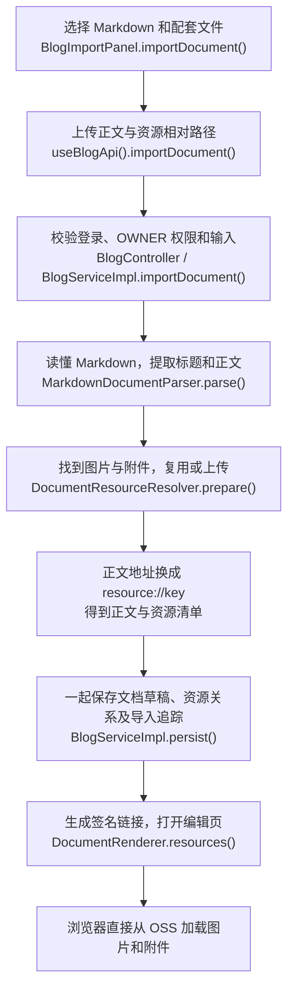

# 文档导入：快速理解核心链路

**目标：把一篇 Markdown 和它用到的图片、附件，变成可编辑的博客草稿。** 当前支持 UTF-8 `.md`，DOCX/PDF 尚未启用。

先记住：**数据库存正文及资源关系，OSS 存实际文件；浏览器通过签名链接直接读取 OSS。**

## 1. 一张图看完整过程

导入接口：`POST /api/v1/blogs/imports`。它创建草稿，**不会直接发布文章**。

## 2. 关键步骤在做什么

1. **前端交齐文件。** 有子目录时选择文档文件夹；前端以所选正文所在目录为基准，上传 `images/a.png` 这样的路径，而不只上传 `a.png`。
2. **后端先留来源记录，再检查和解析。** 检查身份、权限、文件数量/容量、重复路径和正文编码；解析器提取标题与正文，此时尚未保存博客。
3. **沿正文寻找资源。** 根据 Markdown 语法识别图片和附件，代码块里的示例不会当成资源；普通网页超链接保持原样。
4. **处理文件并换成稳定引用。** 文件经过统一 Asset 校验和 OSS 上传；正文中的路径替换成 `resource://key`，资源清单记录它对应哪个 Asset。临时签名 URL 不作为正文保存依据。
5. **保存草稿。** 在同一数据库事务里保存 Document、唯一草稿、资源/标签关系、Blog 和导入结果。以后保存只更新同一草稿，发布时才替换正式正文。
6. **展示时换取链接。** 根据资源清单生成 OSS 签名 URL，前端直接加载；Spring Boot 不转发普通图片字节。

## 3. 图片和附件从哪里来

| 正文中的写法 | 系统怎么处理 |
| --- | --- |
| `images/a.png`、`files/guide.pdf` | 按完整相对路径查找本次上传清单，找到后校验、上传；不会到用户电脑或服务器磁盘补找。 |
| `data:image/...;base64,...` | 图片藏在正文里，先解码、检查大小，再走统一图片校验和上传。支持的 WebP 会转为 PNG。 |
| `https://.../a.png` 图片 | 确认网络图片使用权后，经过地址安全、超时和容量检查再抓取、上传。 |
| `asset://48` | 文件已经上传过，检查就绪、用途及本人归属后直接绑定，不重复上传。 |
| `resource://key` | 后续保存时复用当前文档草稿或正式正文的已有资源；失败远程资源在重新确认使用权后可以重试，key 不变。 |

**本地路径最容易出错：** 正文写 `images/a.png`，上传清单也必须带这个路径。只选单张图片可能只有 `a.png`，因此找不到。Windows 引用 `images\a.png` 会规范为斜杠写法；绝对路径、目录越界仍拒绝。

同一次准备中，“同类型 + 同原始地址”只处理一次。重新导入同一文件夹仍可能创建新草稿、新资产，当前没有全局内容去重。

## 4. 失败后会怎样

- **单个资源出错：** 记录 `INVALID` 或 `FETCH_FAILED` 和具体原因，草稿可以继续保存，管理页提示缺文件、路径问题、编码损坏或格式不支持等。
- **整次准备失败，或文档保存事务回滚：** 尝试清理本次新建且尚未绑定的资源；历史资源和已存在的上传资产不在这次补偿范围内。
- **清理也可能失败：** 数据库回滚不会自动撤销 OSS 上传；当前补偿持锁检查全部业务引用后才删元数据，提交后才删 OSS；外部删除失败仍可能留孤儿对象。

## 5. 想看代码，按这个顺序

| 代码入口 | 重点看什么 |
| --- | --- |
| [BlogImportPanel.vue](../../mai-portfolio-frontend/app/components/BlogImportPanel.vue) / [useBlogImportSelection.ts](../../mai-portfolio-frontend/app/composables/useBlogImportSelection.ts) | `importDocument()` 发起导入；文件选择逻辑保留相对路径。 |
| [BlogServiceImpl.java](../../mai-portfolio-backend/mai-portfolio-modules/mai-portfolio-module-blog/mai-portfolio-module-blog-service/src/main/java/dev/amai/portfolio/blog/service/impl/BlogServiceImpl.java) | `importDocument()` 串起流程，`persist()` 保存并处理事务失败。 |
| [DocumentResourceResolver.java](../../mai-portfolio-backend/mai-portfolio-modules/mai-portfolio-module-blog/mai-portfolio-module-blog-service/src/main/java/dev/amai/portfolio/blog/component/DocumentResourceResolver.java) | `prepare()` 编排正文规范化与失败补偿。 |
| [DocumentReferenceResolver.java](../../mai-portfolio-backend/mai-portfolio-modules/mai-portfolio-module-blog/mai-portfolio-module-blog-service/src/main/java/dev/amai/portfolio/blog/component/DocumentReferenceResolver.java) / [DocumentResourceLoader.java](../../mai-portfolio-backend/mai-portfolio-modules/mai-portfolio-module-blog/mai-portfolio-module-blog-service/src/main/java/dev/amai/portfolio/blog/component/DocumentResourceLoader.java) | `resolve()` 管去重、复用；`load()` 管资源读取、上传、状态，`referencePath()` 管本地引用路径。 |
| [DocumentDataUri.java](../../mai-portfolio-backend/mai-portfolio-modules/mai-portfolio-module-blog/mai-portfolio-module-blog-service/src/main/java/dev/amai/portfolio/blog/component/DocumentDataUri.java) / [DocumentRenderer.java](../../mai-portfolio-backend/mai-portfolio-modules/mai-portfolio-module-blog/mai-portfolio-module-blog-service/src/main/java/dev/amai/portfolio/blog/component/DocumentRenderer.java) | `decode()` 处理内嵌图片；`resources()` 生成展示信息。 |

按流程、引用规则、文件操作分开，是为了让它们各自修改时不牵动整条链路；所有新文件仍复用同一套 Asset 上传能力。

更细的源码、限制与补偿边界见[完整说明](document-import-lifecycle.md)，新接口字段见[博客契约](../api/blog-document.md)。
