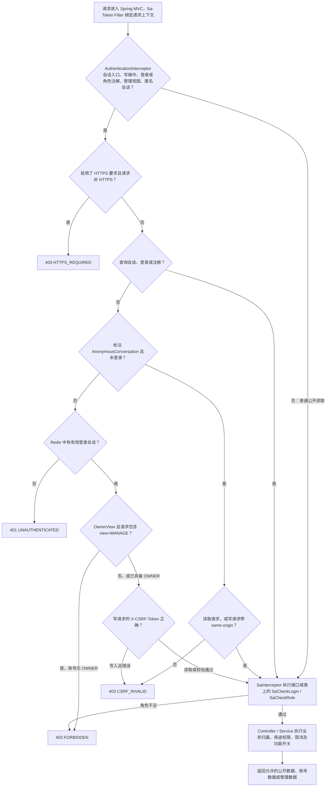

# 网站鉴权链路

## 身份和权限

网站有三种访问身份：匿名访客、已登录账号、带 `OWNER` 角色的站长账号。普通注册只创建普通账号，注册完成后还要登录。站长权限由服务端从登录会话读取，前端页面和请求参数无法授予该角色。

登录成功后，Spring 写入 HttpOnly 的 `portfolio_session` Cookie，在 Redis 中保存会话身份、角色与 CSRF 令牌，并在登录响应中给前端返回 CSRF 令牌。刷新页面后，前端可用 `GET /api/v1/auth/session` 恢复登录状态及 CSRF 令牌。浏览器后续提交受保护的写请求时同时发送 Cookie 和 `X-CSRF-Token`。

数字人访客另有 `portfolio_agent_visitor` Cookie，首次创建匿名会话时由 Spring 签发，路径限于 `/api/agent/v1`，有效期 7 天。Cookie 关联匿名会话归属。登录后数字人用账号 ID 判断归属，访客历史可通过登录后的导入接口转为该账号的会话。

## 请求判定流程

- `AuthenticationInterceptor` 对 `/api/v1/**` 与 `/api/agent/v1/**` 生效。它把 GET、HEAD、OPTIONS 视为安全方法。普通公开读取直接通过这层，进入认证边界的请求才按配置强制 HTTPS。生产配置要求 HTTPS，开发配置允许本机 HTTP。
- `@OwnerView` 表示同一个读取接口有公开和管理两种视图。拦截器检查所有 `view` 参数，任一个等于 `MANAGE` 就要求 `OWNER`。博客和项目列表的公开视图允许匿名读取。博客导出另外标有 `@SaCheckLogin`，即使导出公开内容也要登录。
- `@AnonymousConversation` 只用于数字人的指定会话和执行接口。匿名写入要求浏览器发送 `Sec-Fetch-Site: same-origin`。登录用户调用同一接口时执行会话检查和写入 CSRF 校验。读、发送、续订、停止还会检查账号或访客是否拥有目标记录，找不到与不属于当前身份都返回 404。
- `@SaCheckLogin` 和 `@SaCheckRole(OWNER)` 由后续 Sa-Token 拦截器执行，可标在方法或整个 Controller。资产上传还按用途授权，资产读取还检查上传者。注销用当前登录 ID 和 CSRF 校验，执行后销毁会话。
- 登录和注册的精确路由允许无现有会话和 CSRF 调用，但各自检查来源、请求内容和频率。登录建立会话，注册创建普通账号。

## 接口权限清单

所有登录写操作都需要 CSRF。

| 访问身份 | 接口 | 附加条件 |
| --- | --- | --- |
| 匿名可直接访问 | `GET /api/v1/auth/session` | 返回会话状态，已登录时返回 CSRF 令牌 |
| 匿名可直接访问 | `POST /api/v1/auth/session`、`POST /api/v1/auth/register` | 合法来源、密文请求、限流 |
| 匿名可直接访问 | `GET /api/v1/profile`、`GET /api/v1/projects`、`GET /api/v1/blogs`、`GET /api/v1/blogs/by-slug/{slug}` | 博客和项目列表仅公开视图 |
| 匿名可直接访问 | `GET /api/agent/v1/status` | 返回网站 AI 功能开关 |
| 匿名或已登录 | `POST /api/agent/v1/conversations` | 匿名首次创建会话，随后复用同一访客会话 |
| 匿名或已登录 | `GET /api/agent/v1/conversations/{id}`、`POST /api/agent/v1/conversations/{id}/turns` | 会话归属。发送要求开启 AI，匿名来源每分钟最多 12 次 |
| 匿名或已登录 | `GET /api/agent/v1/executions/{id}`、`GET /api/agent/v1/executions/{id}/events`、`POST /api/agent/v1/executions/{id}/stop` | 执行归属 |
| 登录 | `DELETE /api/v1/auth/session`、`GET/PUT /api/v1/account/profile`、`PUT /api/v1/account/avatar`、`PUT /api/v1/account/password` | 管理自己的账号和会话 |
| 登录 | `GET /api/agent/v1/conversations`、`POST /api/agent/v1/conversations/import` | 列出账号历史或导入本地问答 |
| 登录 | `GET /api/v1/blogs/{id}/export` | 公开视图只导出允许公开的内容，管理视图要求 `OWNER` |
| 登录 | `GET /api/v1/assets/{id}`、`POST /api/v1/assets?usage=AVATAR` | 读取仅上传者或 `OWNER`，上传头像限本人用途 |
| `OWNER` | `GET /api/v1/blogs?view=MANAGE`、`GET /api/v1/projects?view=MANAGE`、`GET /api/v1/blogs/{id}/export?view=MANAGE` | 按请求的管理视图授权 |
| `OWNER` | `GET /api/v1/blogs/{id}`、`GET /api/v1/blogs/imports`、`GET /api/v1/blogs/imports/{taskId}` | 博客管理详情和导入任务 |
| `OWNER` | `POST /api/v1/blogs`、`POST /api/v1/blogs/imports`、`PATCH /api/v1/blogs/{id}`、`PATCH /api/v1/blogs/{id}/properties` | 博客和导入管理 |
| `OWNER` | `POST /api/v1/blogs/{id}/publish`、`POST /api/v1/blogs/{id}/unpublish`、`POST /api/v1/blogs/{id}/restore`、`DELETE /api/v1/blogs/{id}/draft`、`DELETE /api/v1/blogs/{id}` | 发布、下架、恢复和删除 |
| `OWNER` | `GET /api/v1/projects/{id}`、`POST /api/v1/projects`、`PATCH /api/v1/projects/{id}`、`POST /api/v1/projects/{id}/publish`、`POST /api/v1/projects/{id}/unpublish` | 项目管理 |
| `OWNER` | `PATCH /api/v1/profile`、`PATCH /api/v1/account/{accountId}/access`、`GET/POST /api/v1/tags` | 站长资料、账号访问权限和标签 |
| `OWNER` | `POST /api/v1/assets?usage=IMAGE`、`POST /api/v1/assets?usage=ATTACHMENT` | 非头像资产上传 |
| `OWNER` | `GET/PUT /api/v1/admin/agent/settings` | AI 功能关闭时仍可配置 |

Spring 调用 Python 时使用独立的站间 Bearer 凭证。Python 的 `/internal/v1/settings` 与 `/internal/v1/executions` 相关路由校验该凭证，浏览器不接触它。Python 的 `GET /internal/v1/health/live` 与 `GET /internal/v1/health/ready` 用于探活和就绪检测。

## 为什么有两种特殊注解

`OwnerView` 处理**同一读取入口、不同数据视图**。是否需要站长角色由 `view` 决定，单靠静态角色注解无法表达。维护这条分支时要同步核对 Controller 的参数绑定和服务层投影，确保公开查询拿不到管理字段。

`AnonymousConversation` 处理**同一会话操作、两种身份凭证**。登录者使用 Redis 会话与 CSRF，访客用独立 Cookie 保证会话归属并用浏览器同源标记约束写入。Controller 解析身份，数据库查询据此约束会话和执行归属。

排查权限时，按以下顺序读代码：

1. `AuthenticationInterceptor.preHandle` 判断 HTTPS、会话、条件角色和 CSRF。
2. `SecurityAutoConfiguration.addInterceptors` 注册 Sa-Token 注解拦截器。角色来自 `AccountRoleProvider` 读取的会话身份。
3. 对照具体 Controller 的映射及注解，再检查对应 Service 的资源归属规则。
